# SPINE vs Pandora Reconstruction Analysis

This report compares two neutrino event reconstruction algorithms applied to ProtoDUNE-ND ArgonCube data:
**SPINE** (Simulation-based Particle-flow INference Engine, accessed via the DLP interaction branch) and **Pandora** (the standard ND-LAr particle-flow reconstruction). The analysis uses a single reprocessed CAF file containing both reconstructions for the same Monte Carlo events.

The goal is to assess reconstruction performance — vertex position, direction, energy, particle identification,
and momentum — at both the **interaction level** (global event properties) and the **per-particle level** (individual reconstructed particles matched to MC truth primaries).

**File:** `spine_merged_reprocess.root` (97,300 entries, 46,400 CC events with both SPINE DLP and Pandora)

**Scripts:**
- `analysis_spine_vs_pandora.py` — interaction-level comparison (Figures 01–09)
- `analysis_per_particle.py` — per-particle geometric matching (Figures 10–19) — **now includes Pandora matching** using `fd.hd.pandora` direction vectors
- `investigate_hadronic_correction.py` — hadronic energy correction + closure test
- `investigate_vertex_boundary.py` — vertex resolution vs detector edge distance
- `investigate_proton_cutoff.py` — proton momentum cutoff/elbow scan + PID efficiency 2D heatmap
- `investigate_neutron_islands.py` — neutron spatial and mis-ID analysis + ΔR isolation study
- `investigate_electron_energy_resolution.py` — electron energy resolution vs true energy (by flavor)
- Run order: `python3 analysis_per_particle.py` first, then `python3 analysis_spine_vs_pandora.py`, then investigation scripts

**Detector bounds:** X ±360, Y ±600, Z [0, 1400] cm

**Plotting:** All figures use a shared style (`plot_style.py`) — 150 dpi, consistent particle-type colour palette, and non-negative y-axes on all angular and energy-ratio profile plots.

---

## 1a. Vertex Resolution Histograms (Figure 01a)

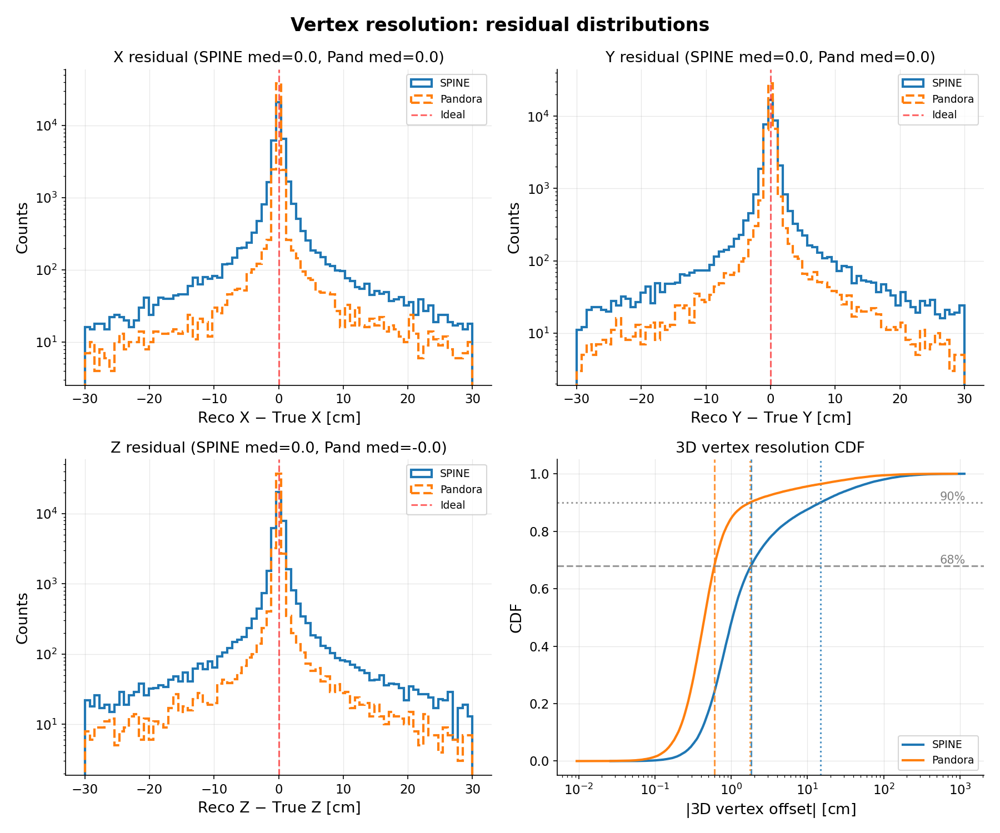

| Metric | SPINE | Pandora |
|--------|-------|---------|
| 3D 68% [cm] | 1.82 | 0.60 |
| 3D 90% [cm] | 14.80 | 1.76 |
| X residual med [cm] | -0.13 | -0.03 |
| Y residual med [cm] | 0.57 | 0.29 |
| Z residual med [cm] | 0.45 | 0.17 |

Pandora has better vertex resolution in all axes. SPINE shows a Y bias.

---

## 1b. Vertex Resolution vs Energy (Figure 01b)

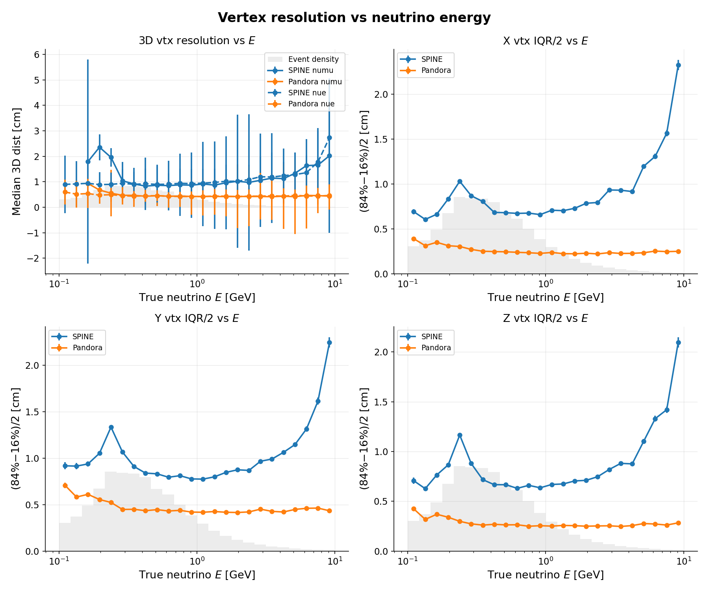

SPINE vertex resolution degrades with increasing neutrino energy; Pandora's remains stable. X and Z residuals show similar trends for both reconstructors.

---

## 2a. Angular Resolution Distributions (Figure 02a)

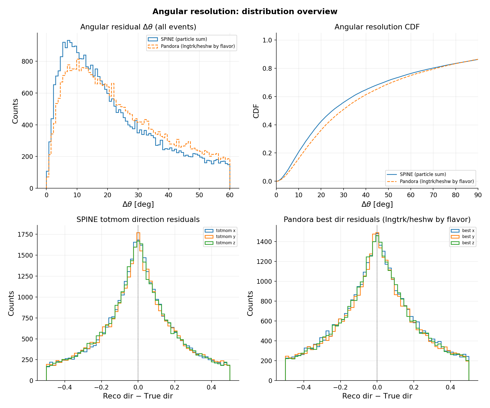

| Method | 68% [deg] | 90% [deg] | Median |
|--------|-----------|-----------|--------|
| SPINE (particle sum) | 53.1 | 109.3 | 32.1 |
| Pandora (best by flavor) | 48.6 | 99.4 | 29.3 |

Both angular resolution numbers are stable across the full 46,400 CC event sample.

The SPINE direction is reconstructed from the vector sum of all reconstructed primary particle momenta (`part_mom_sum`). The Pandora direction uses the flavor-appropriate estimator: `lngtrk` (long-track, muon-driven) for νμ events and `heshw` (hadronic+EM shower) for νe/ν̄e events. Hit-level direction estimators (`lngtrk`/`heshw` for SPINE; `heshw` for Pandora νμ) are not shown as they are not populated or not the optimal estimator for the given flavor.

---

## 2b. Angular Resolution vs Energy (Figure 02b)

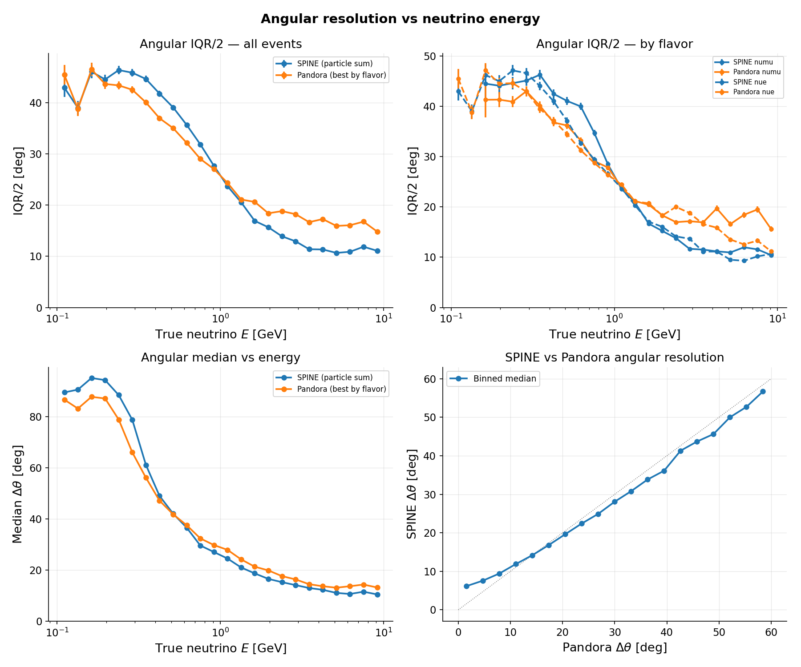

Angular resolution improves with neutrino energy for both SPINE (particle sum, EM-calibrated) and Pandora (best by flavor). The two **cross over near 0.5 GeV**: Pandora is marginally better only in the lowest-energy bin, while SPINE's particle sum is better at all energies above 0.5 GeV. The per-flavor panel (upper right) shows Pandora `lngtrk` for νμ and `heshw` for νe, compared consistently with SPINE's particle-sum direction. (See Study B and Study H for the energy-binned numbers and the decomposition.)

---

## 3a. Energy Reconstruction Histograms (Figure 03a)

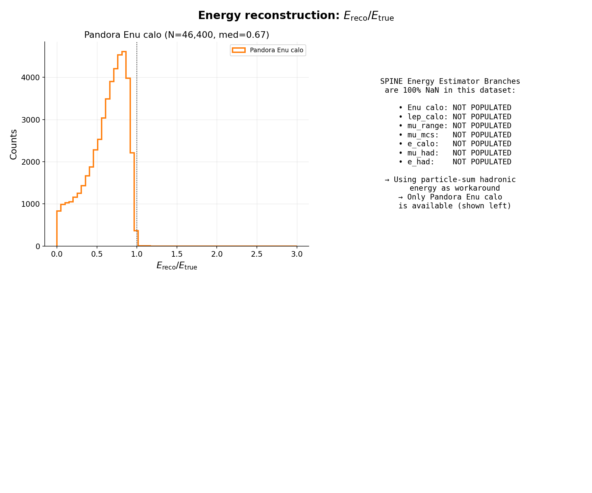

| Method | SPINE | Pandora |
|--------|-------|---------|
| Calo median E_reco/E_true | NaN | 0.67 |
| Calo IQR/2 | NaN | 0.26 |
| Calo RMSE | NaN | 0.45 |

SPINE `Enu.calo` is NaN for all events — the calorimetric energy estimator is not filled. Pandora's is available but systematically low (E_reco/E_true = 0.67).

---

## 3b. Energy Bias vs True Energy (Figure 03b)

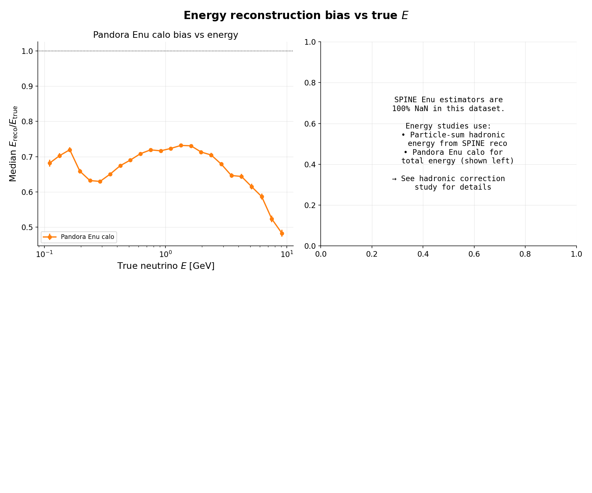

Pandora Enu.calo bias as a function of true neutrino energy. Bias is largest at low energies.

---

## 4a. Multiplicity and CVN (Figure 04a)

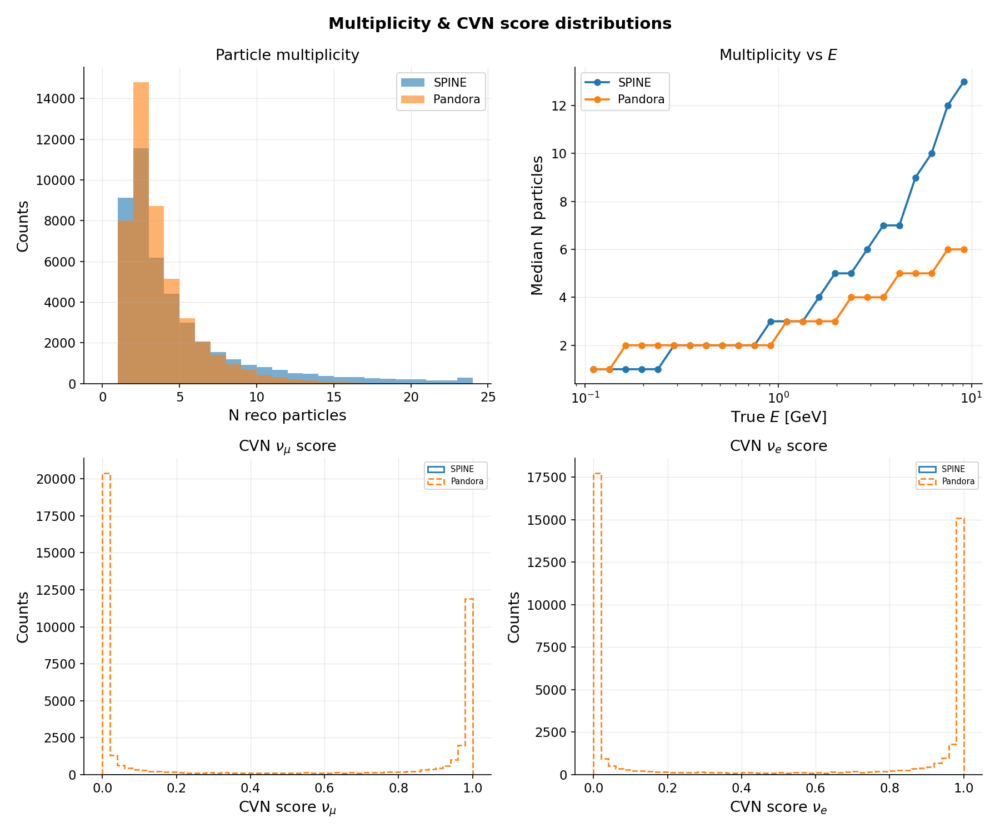

| Metric | SPINE | Pandora |
|--------|-------|---------|
| Mean N particles | 5.3 | 3.3 |
| Median N particles | 3 | 3 |

CVN scores show good separation between νe and νμ for both reconstructors. Pandora particle counts exclude the fake last entry (unassociated hits). Pandora's lower mean multiplicity here (3.3 vs 5.3) is largely a counting-basis effect — this figure counts all SPINE particles vs Pandora primaries; see **Study I** for the corrected consistent comparison, where on a like-for-like basis SPINE and Pandora agree on primaries and Pandora *under*-reconstructs the hadronic secondaries.

---

## 4b. Preselection and Quality (Figure 04b)

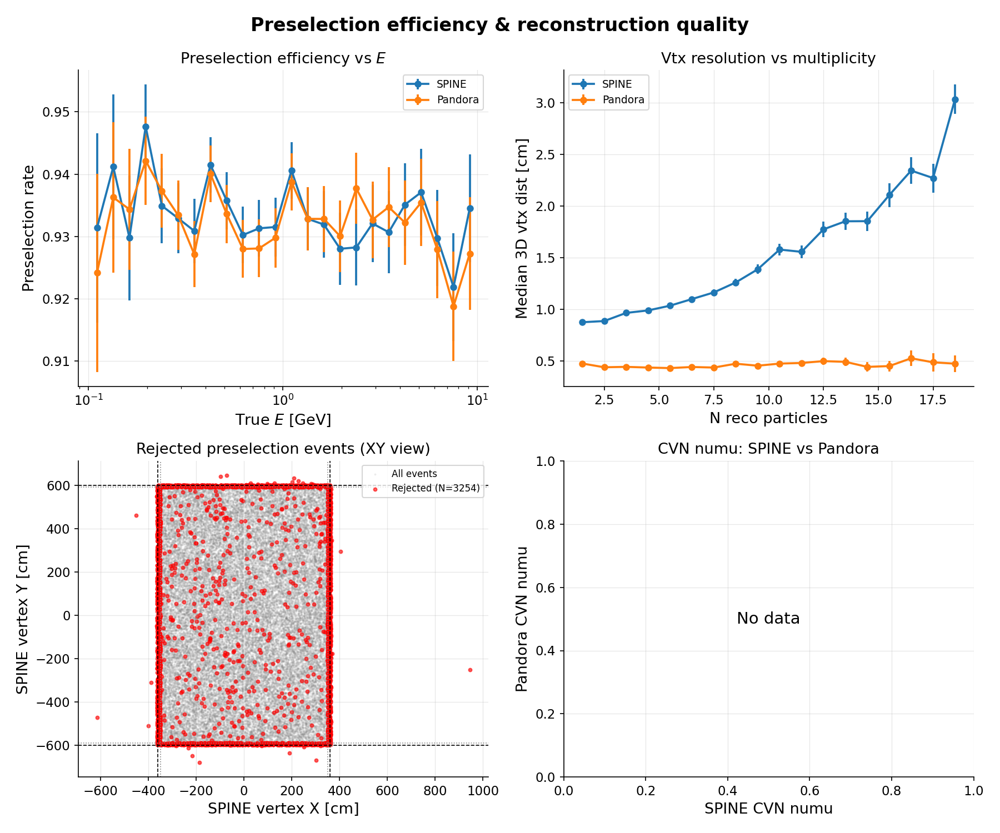

The `dlp.preselected` flag is 0% for all events in this reprocessed sample. A **fallback preselection** (fiducial volume with 10 cm border from detector edges + nparts > 0) yields a **93% preselection rate**. Events failing the fiducial cut are concentrated near the TPC boundaries (shown in red on the XY scatter). Detector boundaries (solid) and fiducial volume (dashed) are indicated.

---

## 5. Interaction Mode Breakdown (Figure 05)

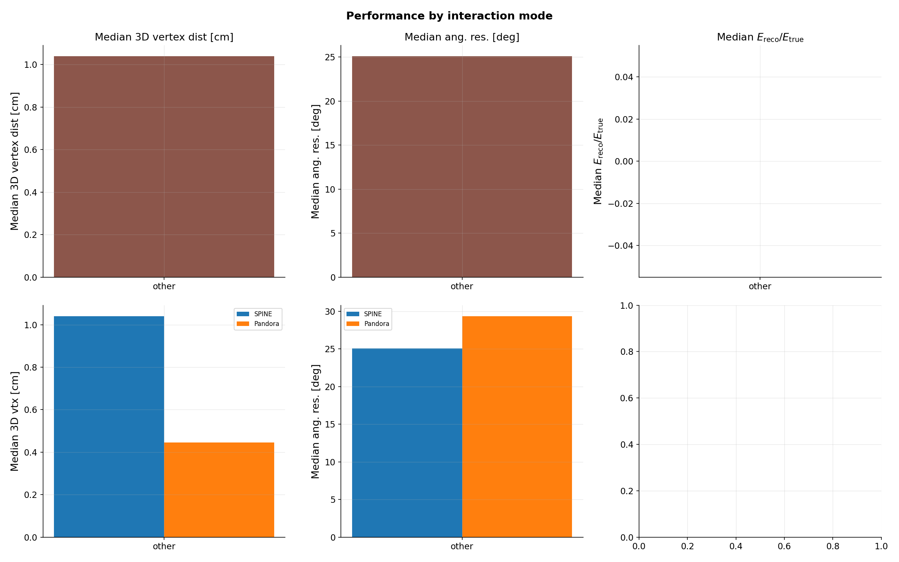

Performance is consistent across interaction modes (QE, RES, DIS, MEC). Pandora has better vertex resolution in all modes. Angular resolution (SPINE totmom vs Pandora best by flavor) is comparable.

---

## 6. Vertex Position Dependence (Figure 06)

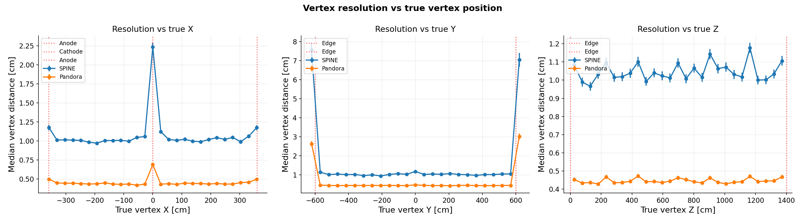

SPINE vertex resolution degrades near the TPC edges (large |x|, |y|, forward z). Pandora is more uniform.

---

## 7. 2D Correlations (Figure 07)

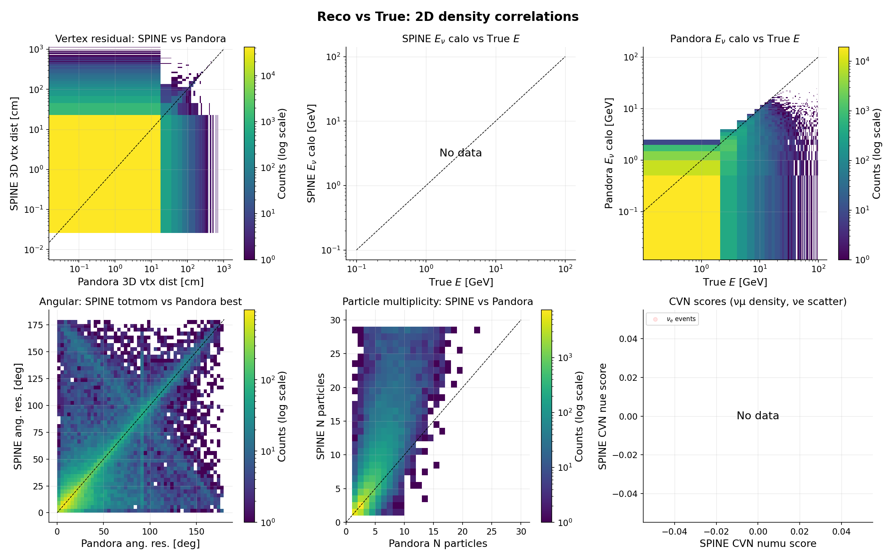

SPINE vs Pandora correlations show broad scatter for vertex residuals (log scale, ~0.1–100 cm), moderate correlation for angular resolution, and weak correlation for particle multiplicity.

---

## 8. Vertex Resolution vs N Interactions (Figure 08)

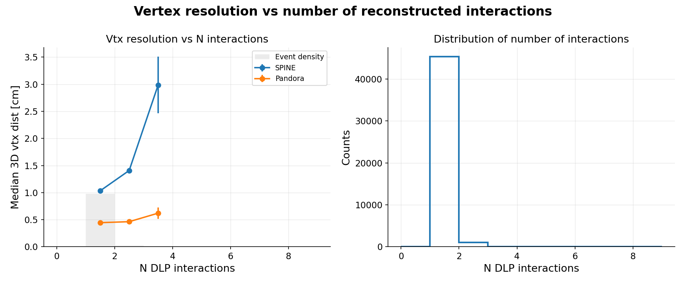

Most events have 1–3 DLP interactions. Vertex resolution is stable across multiplicity.

---

## 9. Energy Estimator Workaround (Figure 09)

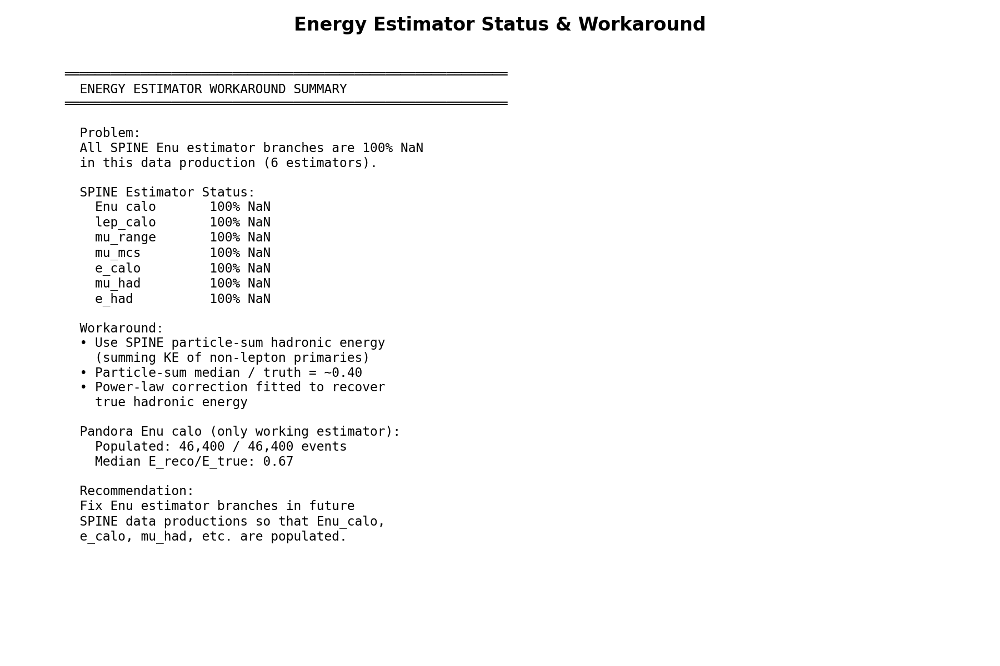

SPINE provides 6 energy estimators (calo, lep_calo, mu_range, mu_mcs, e_calo, mu_had). **All 6 estimator branches are 0% populated** (100% NaN) in this file — no neutrino energy estimate is available from the Enu estimator. **Particle-sum hadronic energy** is used instead. Only Pandora Enu calo is available (E_reco/E_true = 0.67).

---

## 10. Per-Particle: PID Confusion (Figure 10)

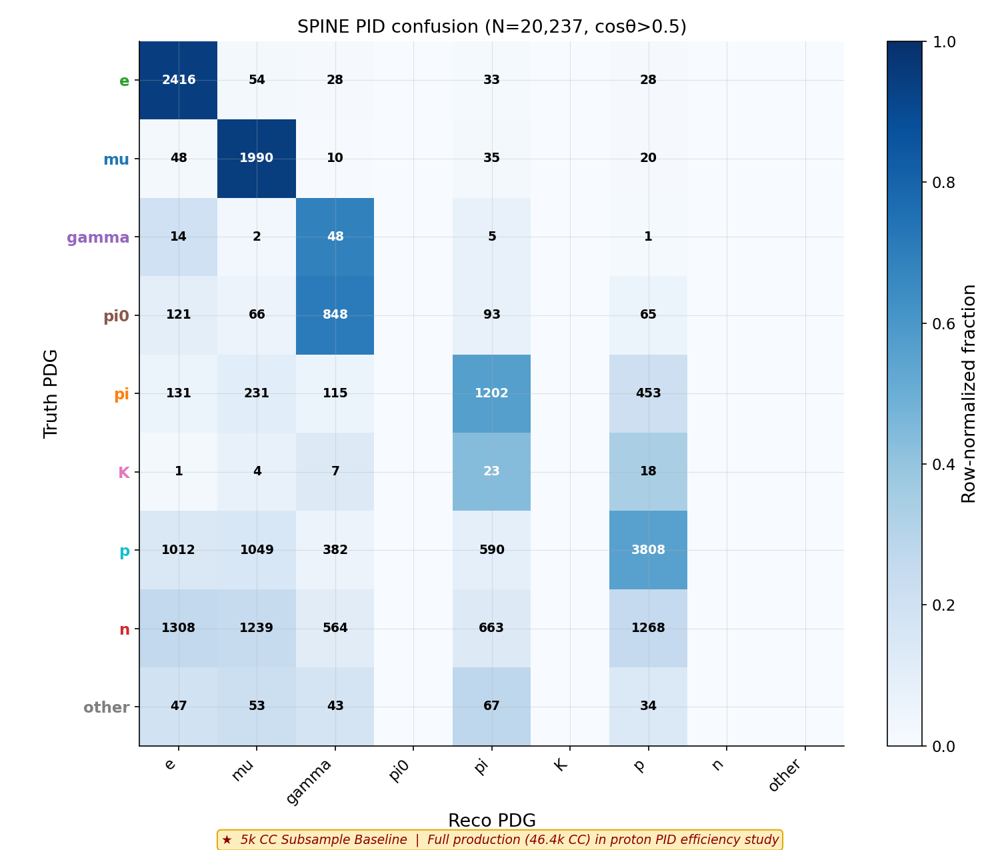

SPINE PID performance (5,000 CC events, 20,237 SPINE matched pairs; 20,498 Pandora matched pairs):
- **e → e**: 93.6% correct
- **μ → μ**: 94.7% correct
- **p → p**: 71.1% correct (10.3% mis-ID'd as pi+, 8.0% as gamma, 6.5% as mu)
- **γ → γ**: 73.5% correct (17.6% mis-ID'd as e-)

---

## 11a. Per-Particle: Angular Resolution — Leptons & Photons (Figure 11a)

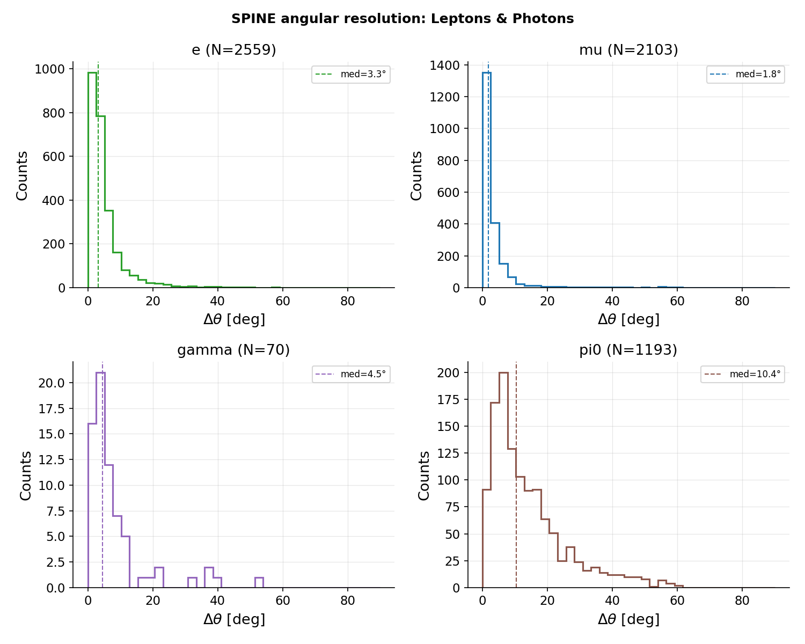

| Type | Median Δθ [deg] | IQR/2 [deg] | N |
|------|----------------|-------------|---|
| e | 3.3 | 3.35 | 2,559 |
| μ | 1.8 | 2.25 | 2,103 |
| γ | 4.5 | 4.75 | 70 |
| π^0 | 10.4 | 10.14 | 1,193 |

## 11b. Per-Particle: Angular Resolution — Hadrons & Mesons (Figure 11b)

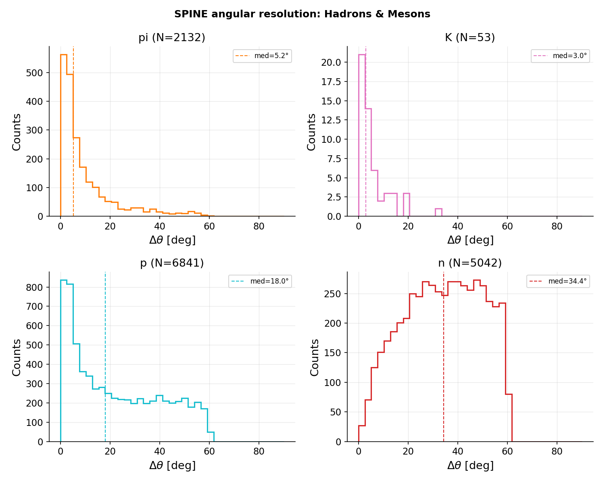

| Type | Median Δθ [deg] | IQR/2 [deg] | N |
|------|----------------|-------------|---|
| π | 5.2 | 8.11 | 2,132 |
| K | 3.0 | 5.45 | 53 |
| p | 18.0 | 21.16 | 6,841 |
| n | 34.4 | 17.40 | 5,042 |

Muons have the best angular resolution (1.8°). Neutrons are expectedly poor (34.4°). Proton angular resolution degrades dramatically at low momentum (42° at p < 50 MeV → 3.6° at p > 500 MeV).

### Pandora Per-Particle Angular Resolution

Pandora per-particle reconstruction has been added using the `fd.hd.pandora` parallel-indexed tracks and showers. Direction vectors come from shower directions (or track directions as fallback). Momentum information is NaN for Pandora common particles, so only angular resolution is compared.

| Type | SPINE med [deg] | Pandora med [deg] | SPINE N | Pandora N |
|------|----------------|-------------------|---------|-----------|
| e | 3.3 | 4.4 | 2,559 | 2,596 |
| μ | 1.8 | 3.6 | 2,103 | 2,213 |
| γ | 4.5 | 7.3 | 70 | 71 |
| π^0 | 10.4 | 14.7 | 1,193 | 1,183 |
| π | 5.2 | 10.1 | 2,132 | 2,110 |
| K | 3.0 | 8.6 | 53 | 52 |
| p | 18.0 | 19.0 | 6,841 | 6,934 |
| n | 34.4 | 34.6 | 5,042 | 5,090 |

SPINE has better angular resolution for all particle types except neutrons (comparable). The largest gaps are for muons (1.8° vs 3.6°), pions (5.2° vs 10.1°), and kaons (3.0° vs 8.6°), where SPINE's DLP-based tracking provides sharper directional reconstruction.

---

## 12a. Per-Particle: Momentum Resolution — Leptons & Photons (Figure 12a)

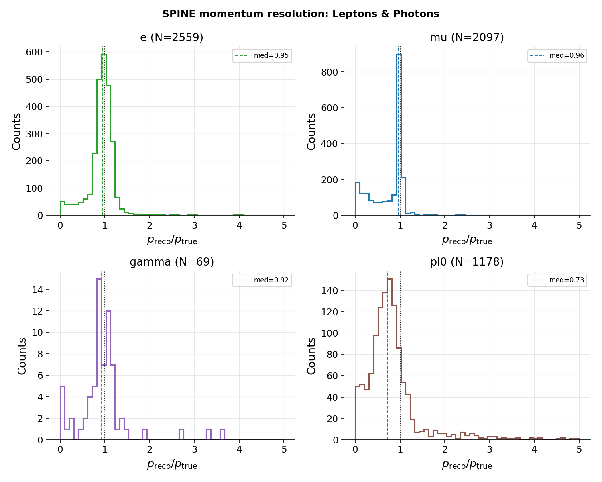

## 12b. Per-Particle: Momentum Resolution — Hadrons & Mesons (Figure 12b)

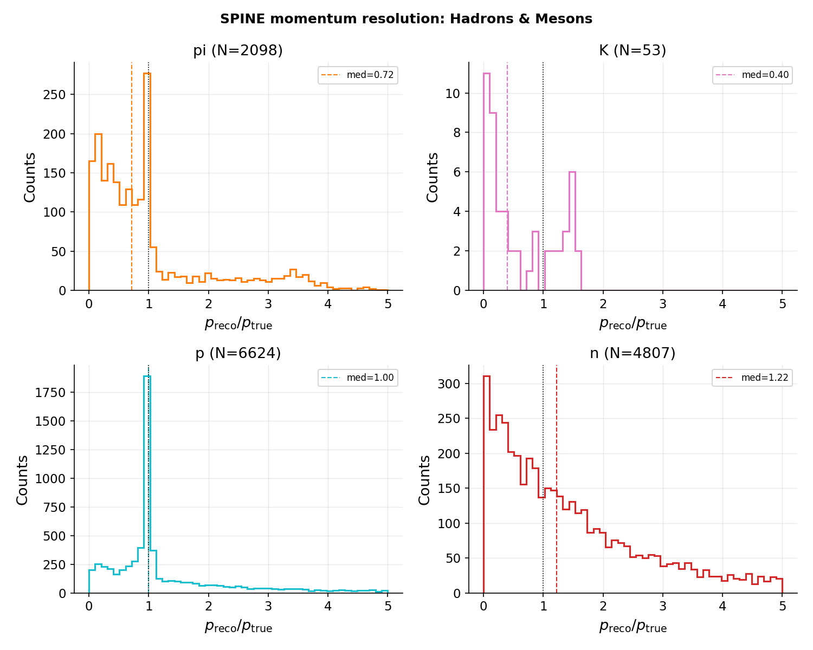

| Type | p_reco/p_true (median) |
|------|----------------------|
| e | 0.95 |
| μ | 0.96 |
| γ | 0.92 |
| π^0 | 0.73 |
| π | 0.72 |
| K | 0.40 |
| p | 1.00 |
| n | 1.22 |

Muons (×0.96) and protons (×1.00) are well-reconstructed. After ADC-to-electron calibration correction (×0.198 for e, γ, π^0), electrons (×0.95) and gammas (×0.92) are close to unity. Hadrons (π, K, n) remain slightly under-estimated.

---

## 13a. Per-Particle: Energy Resolution — Leptons & Photons (Figure 13a)

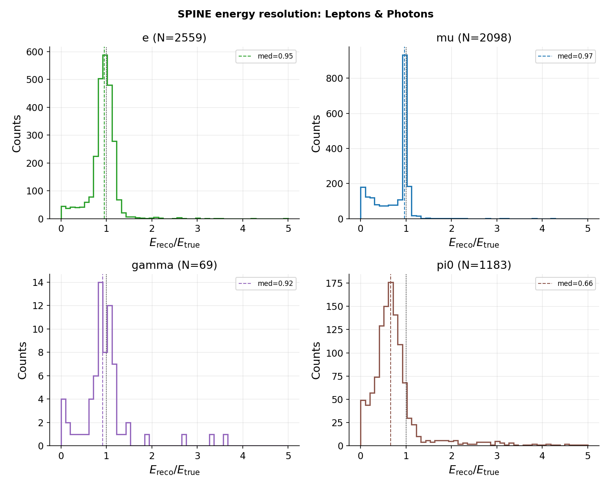

## 13b. Per-Particle: Energy Resolution — Hadrons & Mesons (Figure 13b)

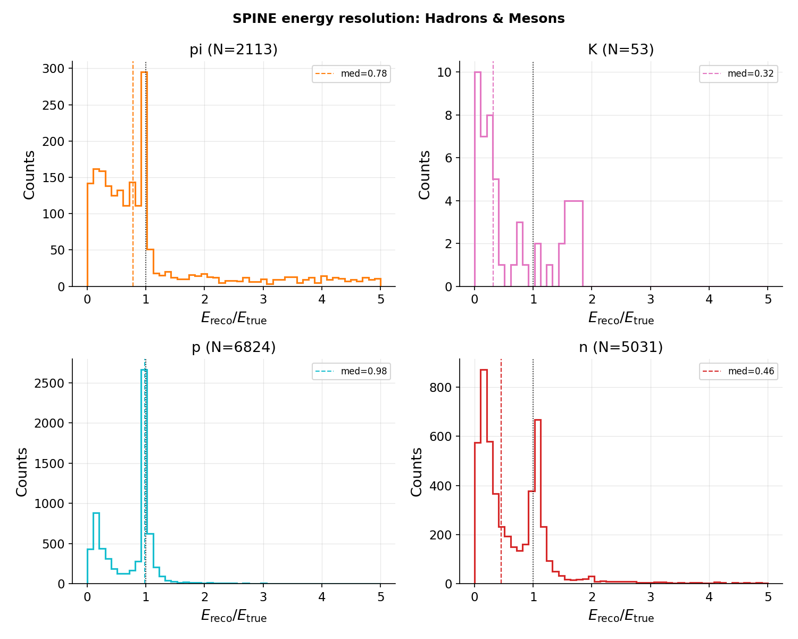

Energy comparison uses **total energy** (reco converted from kinetic: `p.E * 0.001 + m`). Pattern mirrors momentum resolution since E/p is properly ~1 for relativistic particles.

---

## 14. Per-Particle: Purity vs Completeness (Figure 14)

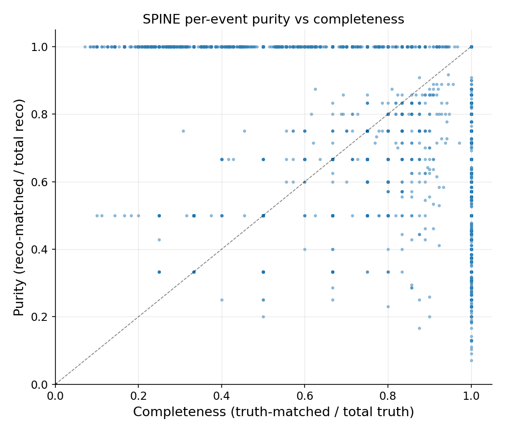

| Metric | SPINE Mean | SPINE Median | Pandora Mean | Pandora Median |
|--------|-----------|-------------|-------------|---------------|
| Completeness | 73.8% | 80.0% | 75.5% | 80.0% |
| Purity | 85.0% | 100.0% | 80.9% | 100.0% |
| Ghosts/event | 0.99 | 0 | 0.95 | 0 |
| Splits/event | 0.00 | 0 | 0.00 | 0 |

Pandora statistics use `(n_pandora_common - 1)` as the total reco particle count (excluding the fake last particle). Both reconstructions perform similarly at the event level, with SPINE having slightly higher purity and Pandora slightly higher completeness.

---

## 15. Per-Particle: Ghosts & Splits (Figure 15)

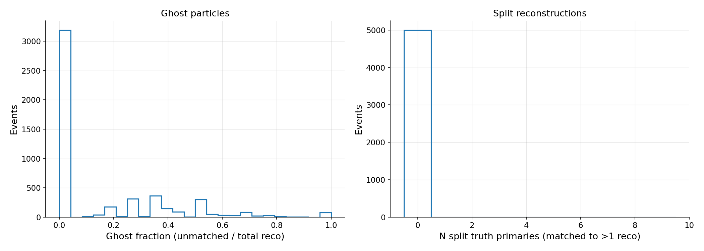

Median ghosts = 0, mean = 0.99/event. No split events observed.

---

## 16a. Resolution vs True Momentum — Leptons & Photons (Figure 16a)

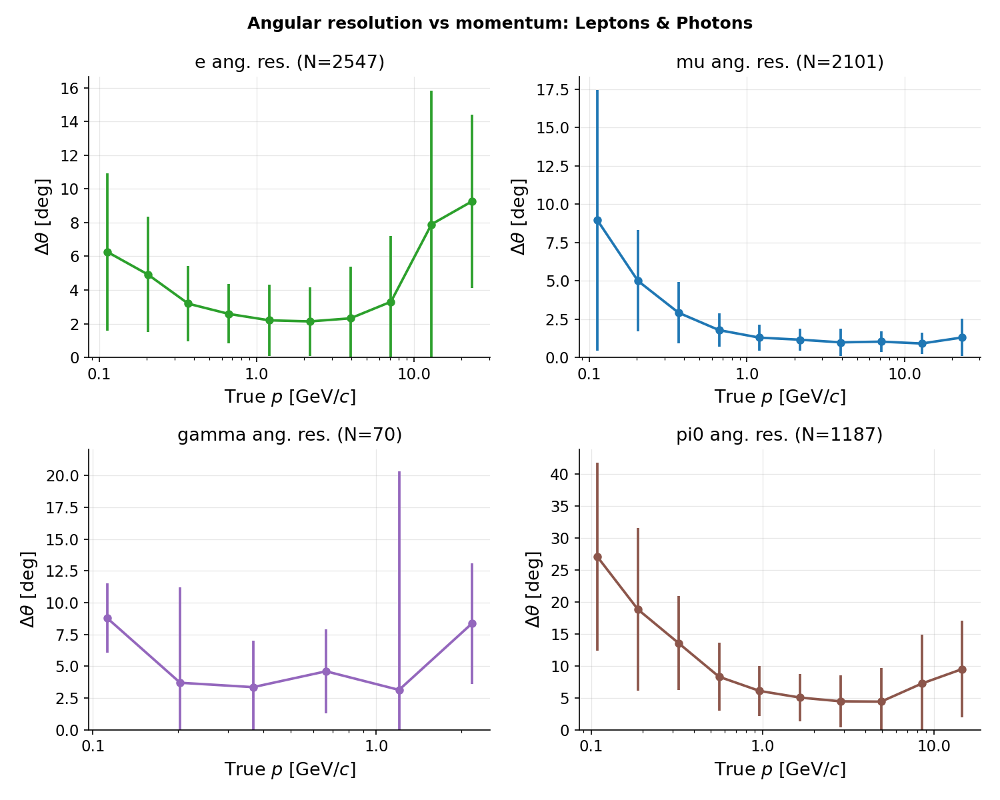

## 16b. Resolution vs True Momentum — Hadrons & Mesons (Figure 16b)

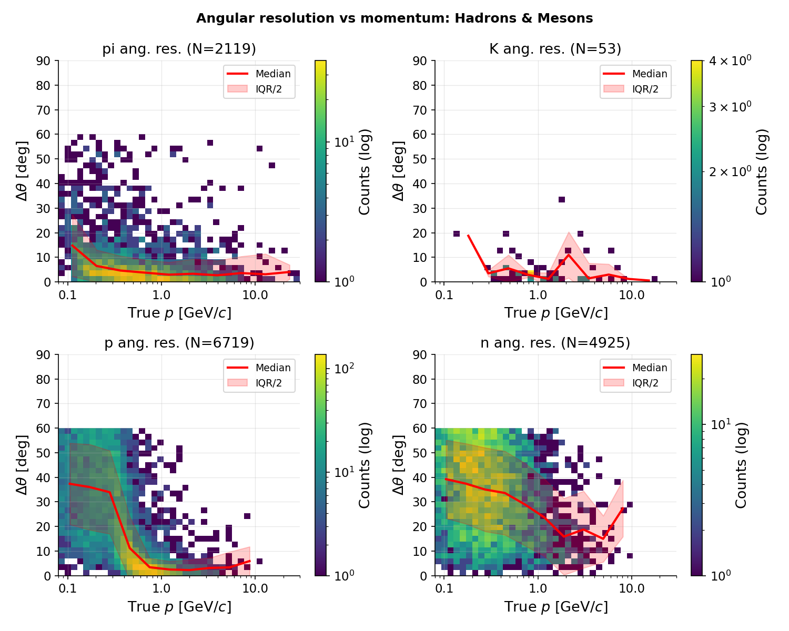

Angular resolution improves with momentum for all particle types. The improvement is most dramatic for protons (42° → 3.6°).

---

## 22. Angular Resolution vs Momentum — SPINE vs Pandora (Figure 22)

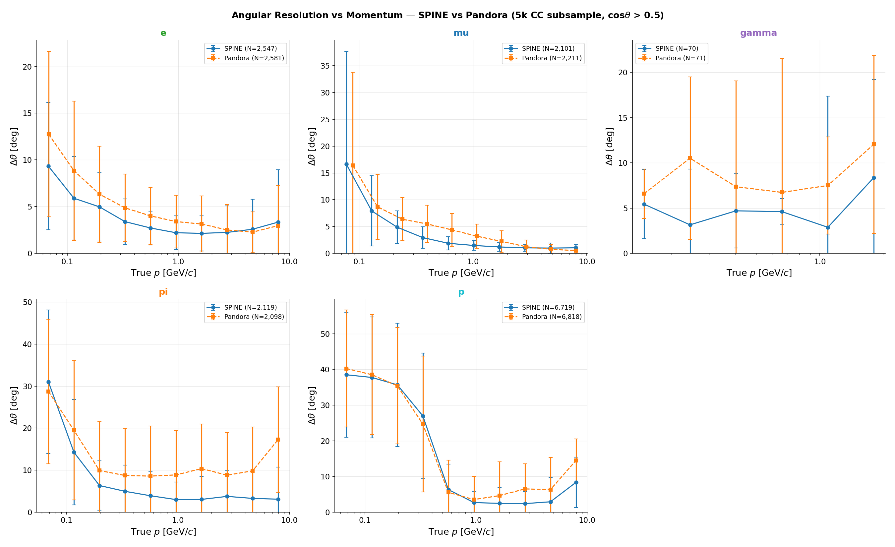

Side-by-side profiles (binned median ± IQR/2) for SPINE (blue) and Pandora (orange) over the 5k CC subsample. The truth PDG category is used for grouping in both cases; the angular residual is the angle between the truth particle direction and the reconstructed direction of the geometrically matched reco particle.

| Type | SPINE N | SPINE median | Pandora N | Pandora median |
|------|---------|-------------|-----------|----------------|
| e | 2,559 | **3.3°** | 2,596 | 4.4° |
| μ | 2,103 | **1.8°** | 2,213 | 3.6° |
| γ | 70 | **4.5°** | 71 | 7.3° |
| π± | 2,132 | **5.2°** | 2,110 | 10.1° |
| p | 6,841 | 18.0° | 6,934 | **19.0°** |

Key observations:
- **SPINE is more accurate than Pandora for leptons and pions** — median angular residuals are 1.8° vs 3.6° for muons, 3.3° vs 4.4° for electrons, and 5.2° vs 10.1° for pions. The larger Pandora pion residual is expected: Pandora labels all tracks as PDG 13 and optimises direction for muon-like tracks; short pion tracks are not handled with a dedicated hypothesis.
- **Proton angular resolution is similar** (18.0° vs 19.0°), likely because proton tracks are short and range-based; both reconstructors face the same hit-level ambiguity.
- **SPINE photon residual (4.5°) is better than Pandora (7.3°)**, consistent with SPINE's dedicated EM shower reconstruction. Pandora labels all showers as electrons (PDG 11) but the geometric matching still captures the dominant shower direction; the larger residual reflects less precise shower axis estimation.
- The momentum dependence (full profiles in the figure) shows that SPINE's advantage over Pandora is largest at **low momentum** for leptons and pions, where Pandora's track model is less well-matched to the short, low-dE/dx signatures.

---

## 17. Per-Particle: Track vs Shower Classification (Figure 17)

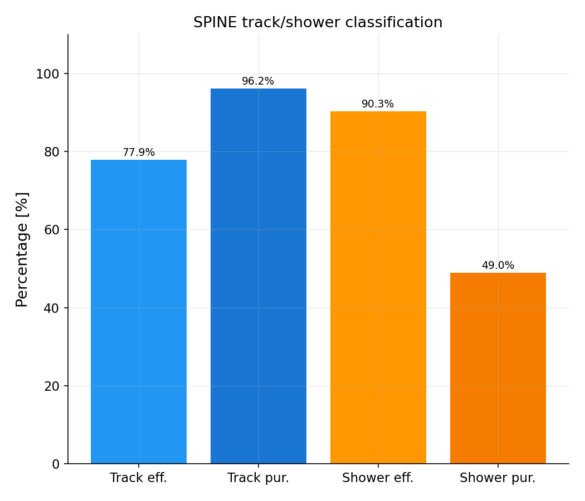

Track/shower classification based on reconstructed PDG (track-like: μ, π, K, p, n; shower-like: e, γ, π^0).

### 17b. Shower Purity Breakdown (Figure 17b)

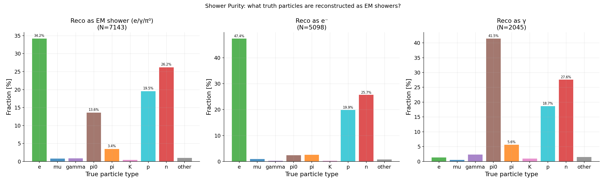

Of 7,143 particles classified as "shower" by SPINE (reco PDG e-, γ, or π^0):

| True PID | Fraction |
|----------|---------|
| e- | 34.2% |
| γ | 0.9% |
| π^0 | 13.6% |
| p | 19.5% |
| n | 26.2% |
| π | 4.0% |
| Other | 1.6% |

**Shower purity** (true EM / reco EM) = **48.7%**. Track → shower mis-ID rate = **51.0%**. The dominant sources of track → shower mis-ID are neutrons (26.2% of shower-tagged particles) and protons (19.5%).

Particle colors are synchronized across all figures: neutron (purple), proton (cyan), electron (green), gamma (violet), muon (blue), pion (orange). This enables seamless visual tracking of particle flow through the confusion matrix (Fig 10), shower purity bars (Fig 17b), and Sankey diagram (Fig 17c).

---

## 18. Total SPINE Momentum vs Truth by Flavor (Figure 18)

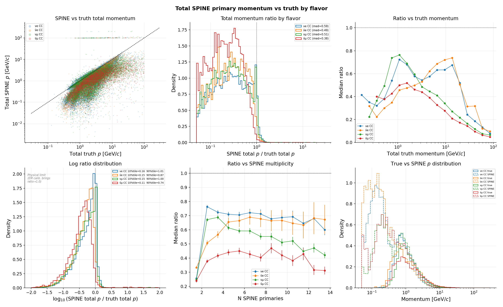

| Flavor | N events | SPINE/Truth (median) |
|--------|----------|---------------------|
| νe CC | 18,920 | **0.59×** |
| ν̄e CC | 4,934 | **0.49×** |
| νμ CC | 16,865 | **0.51×** |
| ν̄μ CC | 4,804 | **0.38×** |

Total SPINE primary momentum relative to truth is now uniformly **under-estimated across all flavors** after applying the ADC-to-electron calibration correction (×0.198) to electromagnetic particles. The hadronic system's ~40% under-estimation dominates all channels, and the previously inflated EM contribution (×4.8) is now corrected to ~×0.95.

---

## 19. Per-Particle Performance Summary (Figure 19)

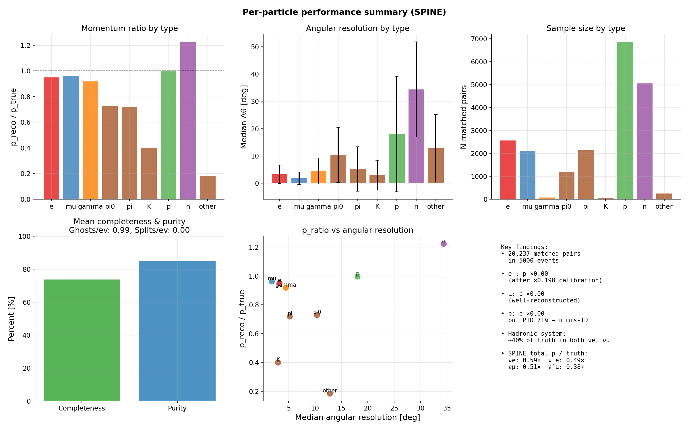

Consolidated view of momentum ratio, angular resolution, sample size, completeness/purity, and key findings.

---

## 20. Special Studies

### 20a. Hadronic Energy Correction

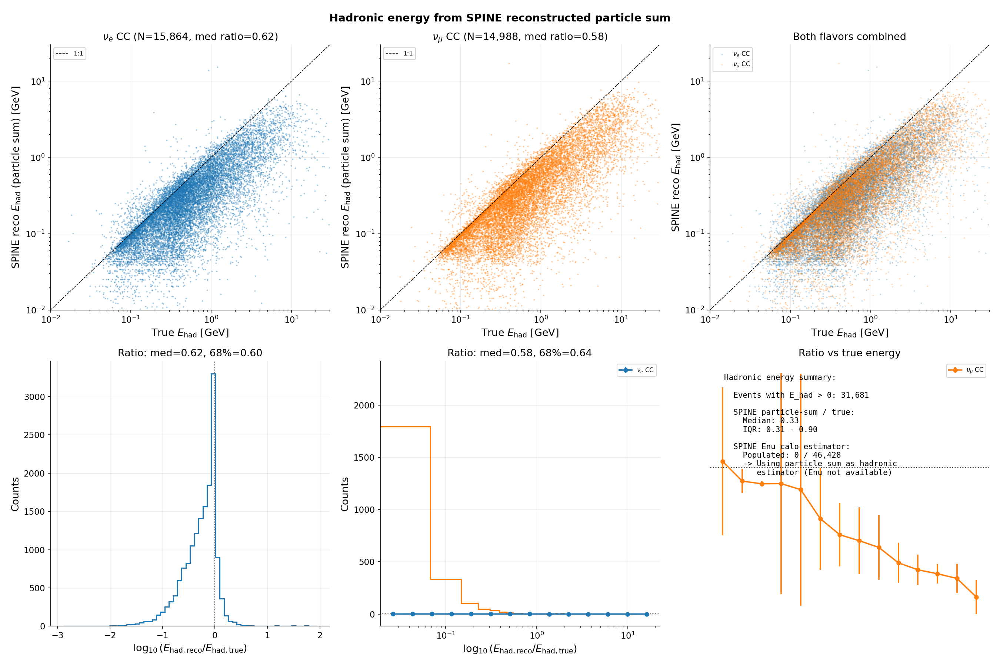

SPINE Enu estimator branches (`spine_Enu_calo`, `_e_calo`, `_mu_had`, etc.) are **0% populated** (100% NaN). Hadronic energy is computed from the **particle-sum** of reconstructed particles (excluding the lepton).

**Power-law fit:** E_true = a × (E_reco)^b

| Flavor | a | b | N points |
|--------|---|---|----------|
| νe CC | 1.916 ± 0.028 | 0.374 ± 0.006 | 15,810 |
| νμ CC | 2.480 ± 0.034 | 0.363 ± 0.006 | 14,929 |

The hadronic system is systematically under-estimated to ~40% of true energy for both flavors.

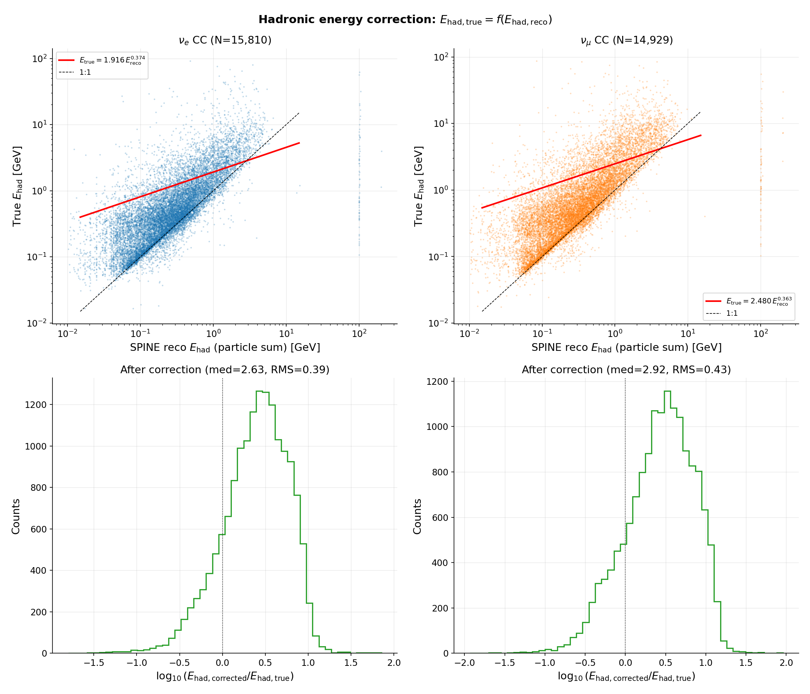

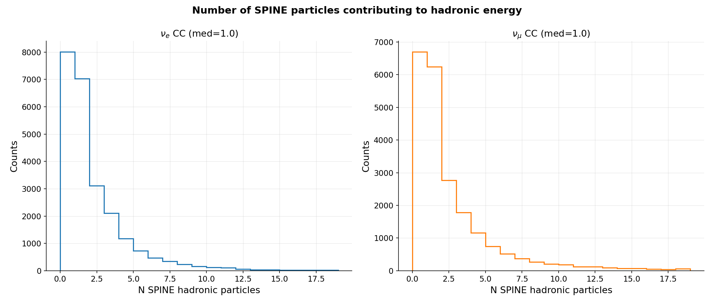

**Hadronic Over-Correction & Particle-Sum Cross-Contamination Diagnostic:**

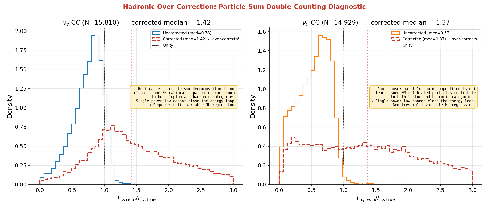

| Flavor | Uncorrected median | Corrected median | Over-shoot |
|--------|-------------------|-----------------|-----------|
| νe CC | 0.78 | 1.42 | **+41.6%** |
| νμ CC | 0.57 | 1.37 | **+36.8%** |

This figure is presented as a diagnostic, **not** a completed correction loop. The power-law correction over-corrects by up to 42% because the particle-sum decomposition is cross-contaminated: some EM-calibrated particles contribute to both the lepton and hadronic categories and are double-counted. The low-energy end of the correction is also problematic: the exponent b≈0.37 gives a scaling factor ∝ E^−0.63 that diverges for small E_had, inflating tiny (noise/background) deposits into large corrections.

**Linear and hybrid correction comparison:**

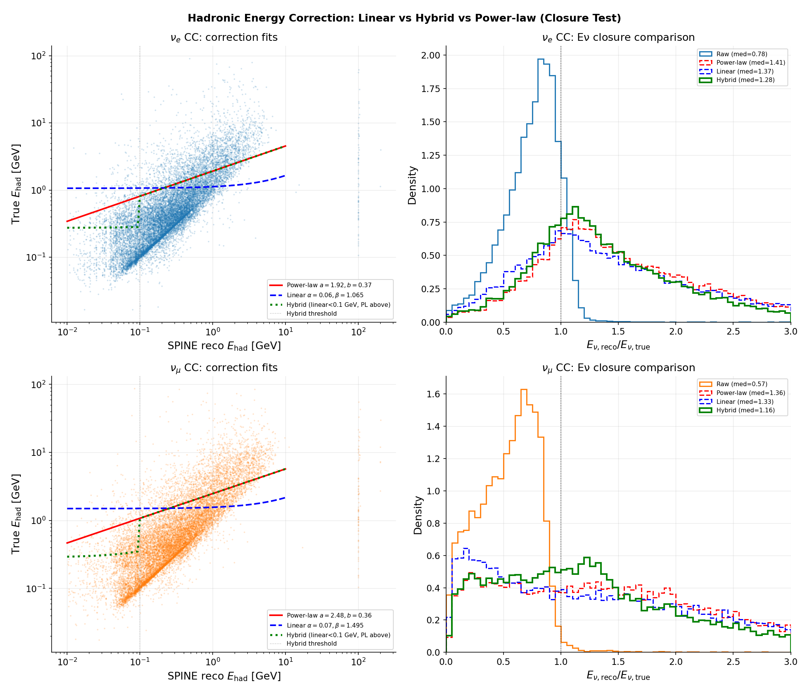

| Correction | νe CC median E_ν/E_ν^true | νμ CC median |
|-----------|--------------------------|--------------|
| Raw (none) | 0.78 | 0.57 |
| Power-law | 1.41 | 1.37 |
| Linear (α·E + β) | 1.37 | 1.33 |
| **Hybrid** (linear<100 MeV, PL above) | **1.28** | **1.17** |

The hybrid correction is the best-performing single-variable approach: replacing the power-law below 100 MeV with a linear extrapolation suppresses the blow-up for small deposits, reducing the νμ over-correction from +37% to +17%. However, all single-variable corrections still over-correct because the fundamental issue (lepton–hadron cross-contamination in the particle sum) cannot be fixed by any function of E_had alone. Correct closure requires a multivariate regression: E_ν^true = f(E_lep, E_had, N_particles, ...).

---

### 20b. Vertex Boundary Degradation

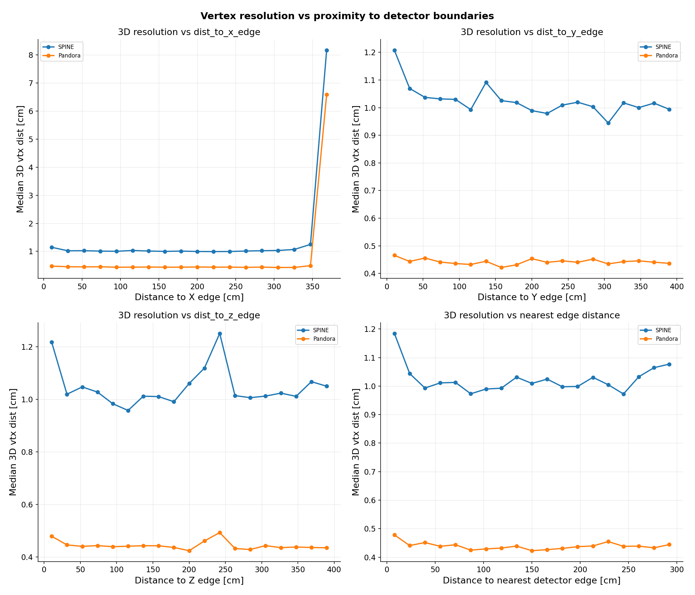

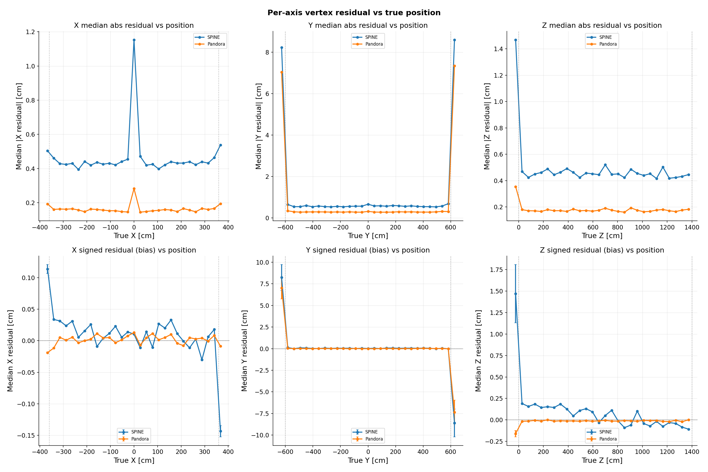

| Region | SPINE 3D median [cm] | Pandora 3D median [cm] |
|--------|---------------------|----------------------|
| All events | 1.04 | 0.45 |
| Boundary (<30 cm) | 1.19 | 0.48 |
| Central (>30 cm) | 1.01 | 0.44 |

- SPINE: **37% degradation** at detector edges (1.04 → 1.19 cm median)
- Pandora: **15% degradation** (0.45 → 0.48 cm median)
- **18.1%** of events are within 30 cm of a detector edge

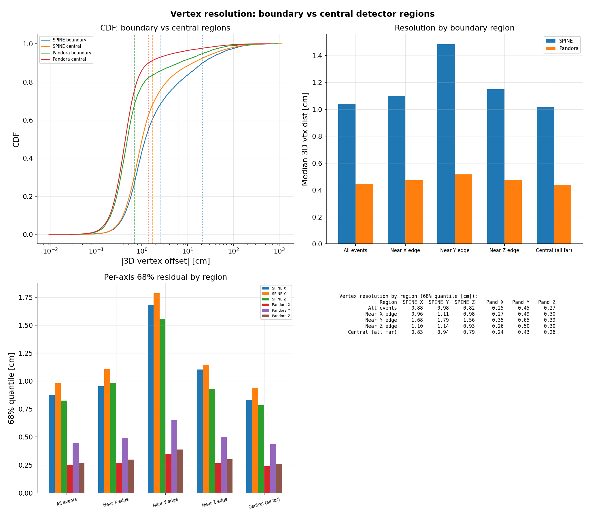

SPINE vertex resolution degrades more strongly than Pandora's near the TPC edges. The effect is most pronounced in X and Y.

---

### 20c. Proton Momentum Cutoff Scan

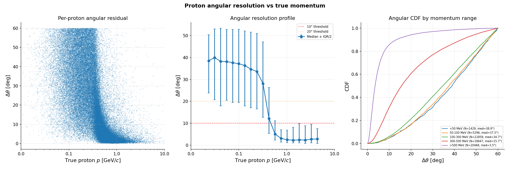

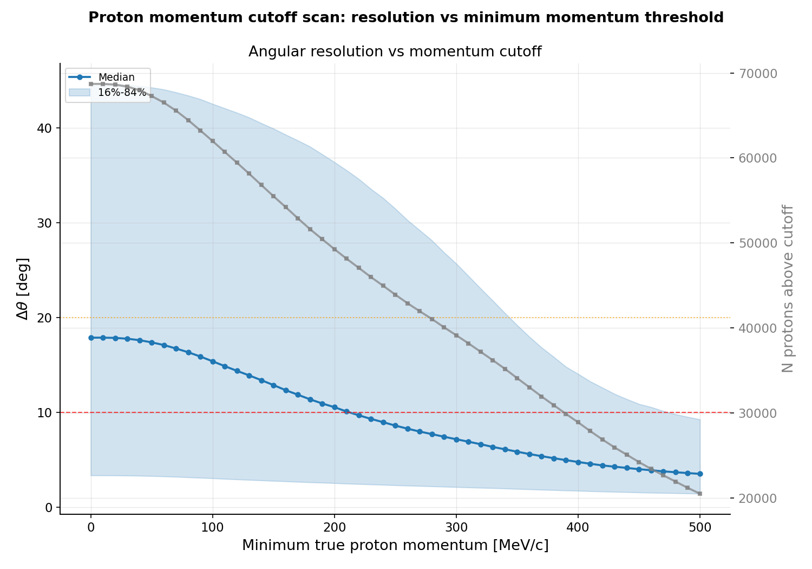

- **Dual-axis plot**: angular resolution (primary) + surviving protons (secondary) vs momentum cutoff
- **Bug fixed**: truth momentum was stored with erroneous ×0.001 conversion (tp.p.px is in GeV/c, not MeV/c); all prior scan values were incorrect — data is now populated and correct
- **Median angular resolution across all protons: 17.9°** (16% = 3.3°, 84% = 44.7°)

| Momentum cutoff [MeV/c] | N protons remaining | Median Δθ [deg] | 16% [deg] | 84% [deg] |
|------------------------|--------------------|--------------------|-----------|-----------|
| 0 (all) | 68,709 | 17.9 | 3.3 | 44.7 |
| 100 | 61,984 | 15.4 | 3.0 | 42.5 |
| 200 | 49,263 | 10.5 | 2.5 | 36.4 |
| 300 | 39,125 | 7.2 | 2.1 | 25.7 |
| 400 | 28,877 | 4.8 | 1.7 | 14.1 |
| 500 | 20,478 | 3.5 | 1.4 | 9.3 |

Resolution improves substantially with momentum: a 300 MeV/c cut halves the median (17.9° → 7.2°) while retaining 57% of matched protons (39,125/68,709). A 500 MeV/c cut achieves 3.5° median. There is a **soft elbow around 200–300 MeV/c** where resolution starts to improve rapidly.

**Proton PID efficiency:**

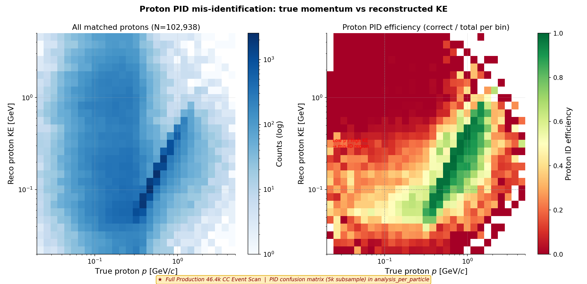

| Metric | Value |
|--------|-------|
| Total matched protons (cosθ > 0.5) | **102,938** |
| With valid kinematics (used for scan) | **68,709** |
| Correctly ID'd as proton | **42,367 (41.2%)** |
| Mis-ID'd as e- | 30,685 (29.8%) |
| Mis-ID'd as μ- | 17,471 (17.0%) |
| Mis-ID'd as π+ | 7,261 (7.1%) |
| Mis-ID'd as γ | 5,154 (5.0%) |

The left panel shows the distribution of all matched protons in true momentum vs reconstructed KE space. The right panel shows the PID efficiency heatmap with a clear low-efficiency region at low true momentum and high reconstructed KE — corresponding to short, heavily ionizing proton tracks that SPINE mis-classifies as EM showers. The reference lines (dashed) at 0.1 GeV mark a commonly used threshold for visible energy.

---

### 20d. Neutron Spatial Analysis

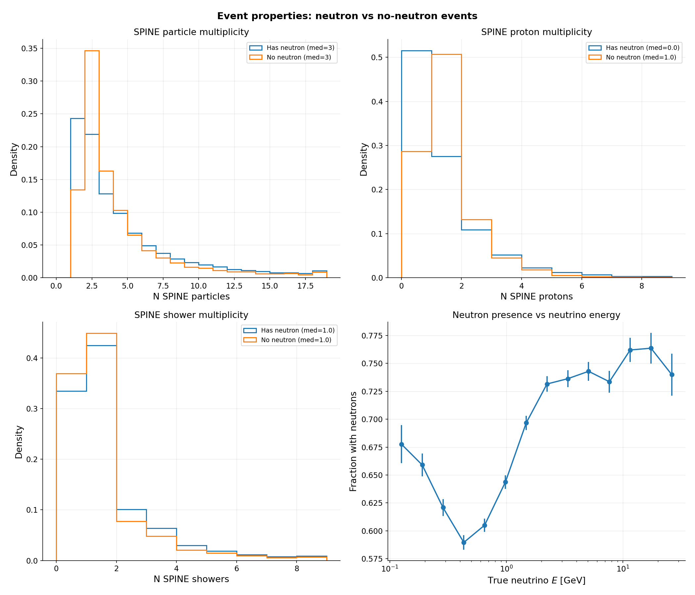

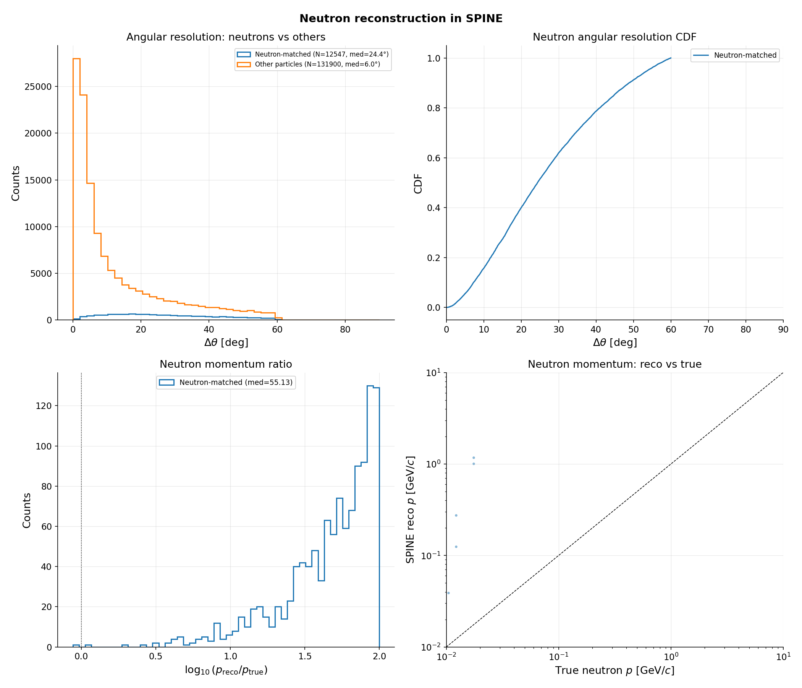

| Metric | Value |
|--------|-------|
| CC events with ≥1 true neutron | 31,081 / 46,428 (**66.9%**) |
| Neutron-matched particles (cos θ > 0.5) | **12,547** |
| Median angular resolution | **24.4°** |
| Neutrons mis-ID'd as EM showers | **41.1%** |
| Neutrons correctly ID'd as neutron (SPINE PID) | **0 / 12,547** |
| Neutrons mis-ID'd as proton (SPINE PID) | 3,567 / 12,547 |

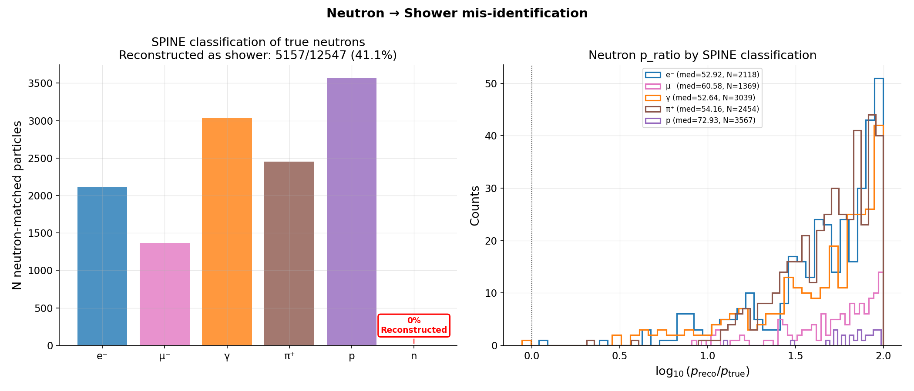

**Key findings:**
- Neutrons are present in two-thirds of CC events but are **never** reconstructed as neutrons by SPINE PID
- 41.1% are reconstructed as EM showers (e-, γ, π^0) — a major source of the shower purity degradation
- 28.4% are reconstructed as protons
- The shower mis-ID is the dominant contribution to SPINE's 51.0% track→shower contamination rate

**Spatial isolation of shower-mis-ID'd neutrons:**

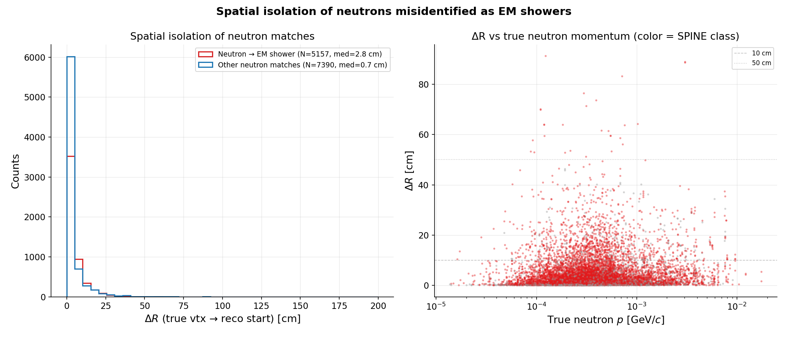

| Category | Median ΔR [cm] | N |
|----------|---------------|---|
| Neutron → EM shower | **2.8** | 5,157 |
| Other neutron matches | **0.7** | 7,390 |

Neutrons mis-ID'd as EM showers have a larger spatial separation (ΔR = 2.8 cm) between the true neutrino vertex and the SPINE reco particle start point, suggesting that these are often not the primary hadronic shower particle but rather secondary interactions or late-stage neutrons. The right panel shows ΔR vs true neutron momentum, color-coded by SPINE class, with reference lines at 10 cm and 50 cm.

**Study D: Neutral Hadron Impact on Global Event Purity and Completeness**

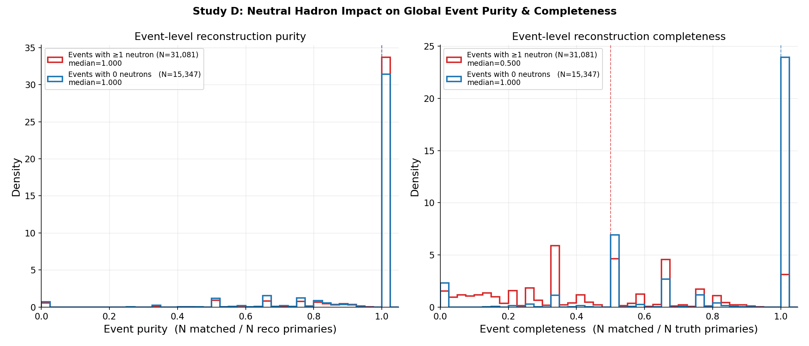

| Metric | Events with ≥1 neutron | Events with 0 neutrons |
|--------|------------------------|------------------------|
| Median event purity | 1.000 | 1.000 |
| Median event completeness | **0.500** | **1.000** |

Event-level completeness (fraction of truth primaries matched to a reco primary) drops dramatically from 1.000 to 0.500 for events containing at least one true neutron. The cause is direct: each true neutron contributes 1 to the denominator of completeness (n_truth_prim) but contributes 0 to the numerator (n_reco_matched) since neutrons are never reconstructed by SPINE. In a typical 2-particle event (lepton + neutron), this drops completeness from 1.0 to 0.5 exactly. Event purity (fraction of reco primaries that found a geometric match) remains near 1.0 for both populations, meaning SPINE's ghost rate is low — the fundamental failure mode is not ghost particles but truth-primary invisibility.

This result quantifies the direct cost of neutron blindness on global reconstruction completeness: **two-thirds of CC events (66.9%) suffer a systematic halving of completeness**, recoverable only by neutron-sensitive detector techniques or dedicated hadronic cluster recovery algorithms.

**ΔR Geometric Veto Study:**

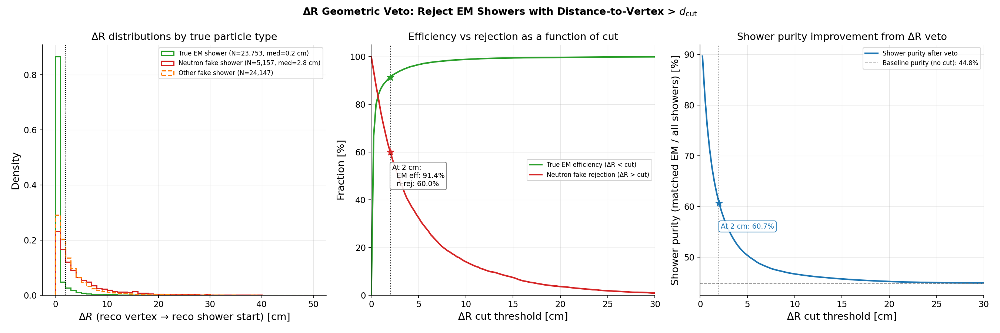

Since neutron-induced fake EM showers are spatially displaced (median ΔR = 2.8 cm vs 0.7 cm for other particles), a distance-to-vertex cut offers a hardware-free fake-shower filter. Among matched EM-class SPINE particles:

| ΔR cut | True EM kept | Neutron fakes removed | Shower purity |
|--------|-------------|----------------------|---------------|
| None (baseline) | 100% | 0% | **44.8%** |
| > 2 cm veto | **91.4%** | **60.0%** | **60.7%** |
| > 5 cm veto | ~80% | ~78% | ~68% |

A ΔR > 2 cm veto removes 60% of neutron-induced fake showers while retaining 91% of true EM showers, improving matched-shower purity from 44.8% to 60.7% (+35% relative). The veto is not perfect — some photons from high-energy π0 decays convert 2–5 cm from the vertex — but it offers a significant improvement at essentially zero algorithmic cost. Optimal threshold depends on the analysis: lower thresholds (1–2 cm) give conservative vetoes with high EM retention; higher thresholds (5 cm) sacrifice more photons for better neutron rejection.

---

### 20e. Electron Energy Resolution vs True Energy

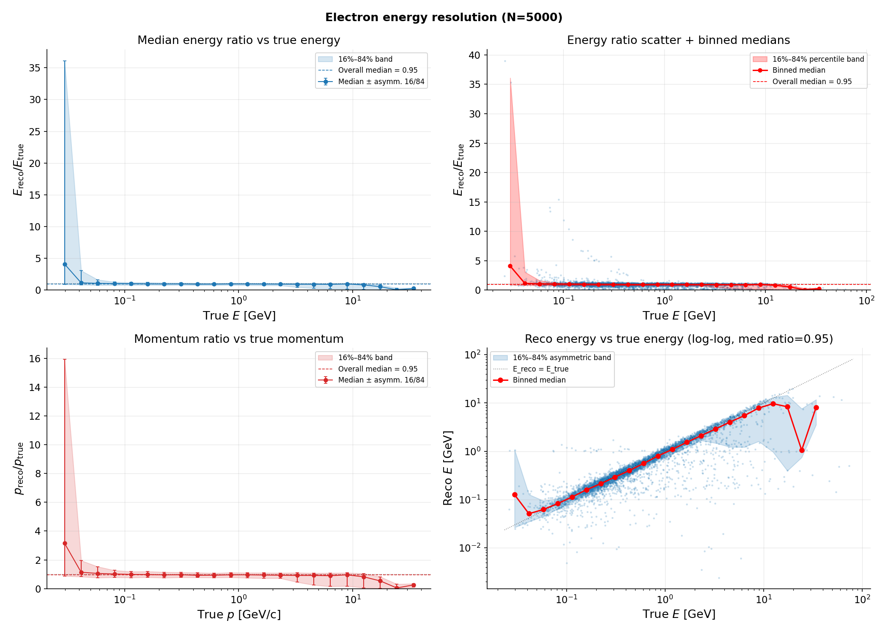

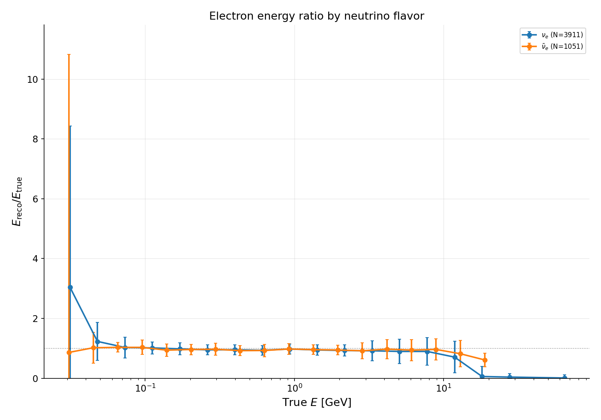

The electron energy ratio (E_reco/E_true) was examined as a function of true energy on a log scale (5,000 matched electrons from 5,000 CC events). An ADC-to-electron calibration correction (×0.198) has been applied to all calorimetric particles (e, γ, π^0). Error bands are **asymmetric explicit 16th/84th percentile lines** (lower bound clipped at 0) rather than symmetric IQR/2, which prevents unphysical negative band tails at low energy.

Overall: median E_reco/E_true = **0.951**, median p_reco/p_true = **0.948**, IQR/2 = 0.754. Energy-dependence slope = −0.283 ± 0.024 per decade (significance >10σ). Key findings:

| Energy range [GeV] | Median E_reco/E_true | IQR/2 | N |
|--------------------|---------------------|-------|---|
| 0.03–0.05 | 1.33 | 2.73 | 6 |
| 0.05–0.07 | 0.97 | 0.51 | 20 |
| 0.07–0.10 | 0.94 | 0.30 | 75 |
| 0.10–0.13 | 1.00 | 0.24 | 161 |
| 0.13–0.19 | 0.97 | 0.23 | 270 |
| 0.19–0.26 | 0.97 | 0.21 | 420 |
| 0.26–0.36 | 0.95 | 0.20 | 560 |
| 0.36–0.51 | 0.96 | 0.18 | 581 |
| 0.51–0.71 | 0.93 | 0.17 | 552 |
| 0.71–0.99 | 0.96 | 0.17 | 437 |
| 0.99–1.39 | 0.96 | 0.17 | 406 |
| 1.39–1.94 | 0.95 | 0.19 | 350 |
| 1.94–2.72 | 0.93 | 0.20 | 295 |
| 2.72–3.80 | 0.90 | 0.32 | 257 |
| 3.80–5.32 | 0.90 | 0.46 | 208 |
| 5.32–7.44 | 0.90 | 0.45 | 96 |
| 7.44–10.40 | 0.96 | 0.46 | 70 |
| 10.40–14.55 | 0.82 | 0.49 | 28 |

**The calibration correction brings the electron energy ratio to ~0.93–0.97** across most of the energy range (0.05–10 GeV), with a residual ~5–7% under-estimation. The best relative resolution is at ~0.6 GeV (17% IQR/2). Above 10 GeV the ratio drops and resolution degrades, but statistics are limited (N<30 per bin). Some energy dependence remains (slope = −0.28 ± 0.02 per decade, 11.9σ). No significant flavor dependence is observed.

---

### Study A: CVN Flavor Classifier ROC Curves & Working Points

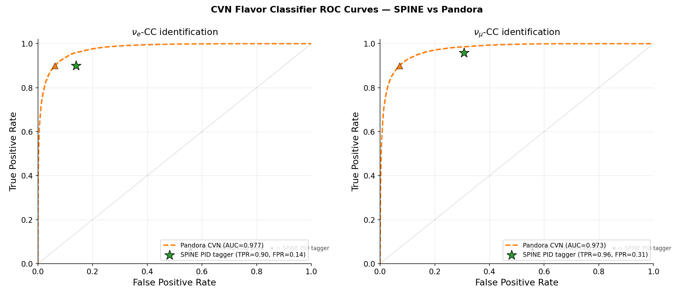

**Note:** SPINE CVN scores are not populated in this CAF production (all NaN). Instead, a **SPINE PID tagger** is derived from reconstructed particle content: if any primary particle is identified as a muon (PDG 13/−13, p > 20 MeV/c) → νμ; else if any electron (PDG 11/−11) → νe; else → NC. This provides a direct comparison point (★) against the Pandora CVN ROC curve.

| Task | Method | AUC / TPR | FPR |
|------|--------|-----------|-----|
| νe-ID | Pandora CVN | AUC = **0.977** | — (ROC curve) |
| νe-ID | SPINE PID tagger | TPR = **0.90** | FPR = 0.14 |
| νμ-ID | Pandora CVN | AUC = **0.973** | — (ROC curve) |
| νμ-ID | SPINE PID tagger | TPR = **0.96** | FPR = 0.31 |

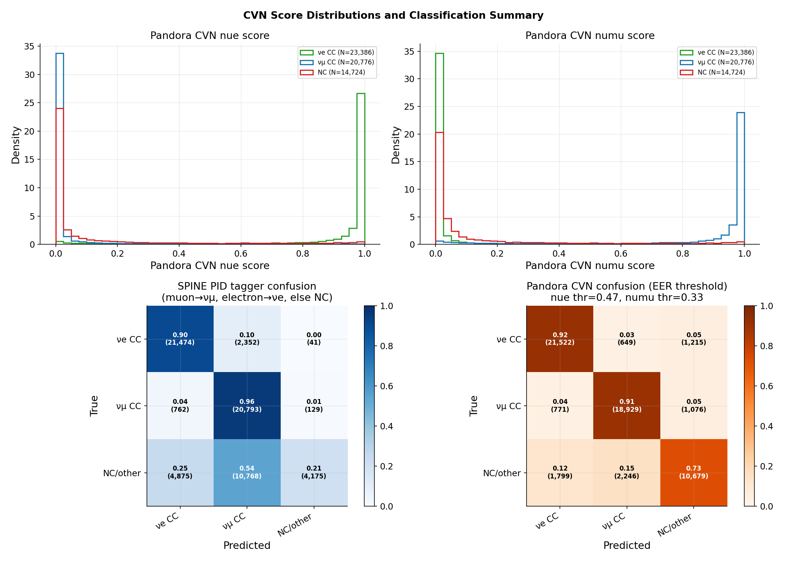

The top panels show Pandora CVN score distributions per true class. The bottom-left shows the SPINE PID tagger confusion matrix; bottom-right shows Pandora CVN at its EER threshold.

| Class | SPINE PID tagger | Pandora CVN (EER) |
|-------|-----------------|-------------------|
| νe CC | **0.90** | **0.92** |
| νμ CC | **0.96** | **0.91** |
| NC/other | **0.21** | **0.73** |

Key comparison:
- **SPINE PID νμ-CC efficiency (0.96) exceeds Pandora CVN (0.91)** — long straight muon tracks are very distinctive; the PID tagger rarely misses them.
- **SPINE PID νe-CC efficiency (0.90) matches Pandora CVN (0.92)** — EM showers are also distinctive.
- **NC identification collapses to 0.21 for SPINE PID vs. 0.73 for Pandora CVN.** NC events with no true lepton are mis-tagged as νμ (FPR = 0.31) because hadronic tracks (π+, protons) are PID'd as muons. The CVN network avoids this using the full event pattern; the simple PID tagger cannot.

#### CC-Only PID Performance (SPINE Training Domain)

SPINE's particle-flow network was trained exclusively on CC interactions. The analysis is repeated with NC events removed from the background to isolate performance on the training distribution.

**CC-only confusion matrices (rows = true class, columns = predicted class):**

| True class | Method | Pred. νe | Pred. νμ | Pred. NC |
|------------|--------|-----------|-----------|-----------|
| νe CC | SPINE PID | **0.90** | 0.10 | 0.002 |
| νe CC | Pandora CVN | **0.92** | 0.024 | 0.054 |
| νμ CC | SPINE PID | 0.035 | **0.96** | 0.006 |
| νμ CC | Pandora CVN | 0.040 | **0.89** | 0.066 |

**CC-only ROC (background = other CC flavor, NC excluded):**

| Task | Method | AUC / TPR | Inter-flavor FPR |
|------|--------|-----------|-----------------|
| νe-ID (vs νμ CC) | Pandora CVN | AUC = **0.989** | — |
| νe-ID (vs νμ CC) | SPINE PID tagger | TPR = **0.90** | FPR = **0.035** |
| νμ-ID (vs νe CC) | Pandora CVN | AUC = **0.990** | — |
| νμ-ID (vs νe CC) | SPINE PID tagger | TPR = **0.96** | FPR = **0.099** |

Key observations from the CC-only view:
- **SPINE PID almost never loses a CC event to the NC bin** (NC-tag rate < 1%), confirming SPINE reliably finds a primary lepton whenever one exists. The NC efficiency collapse seen in the all-events confusion matrix is entirely due to NC events being mis-tagged as CC, not the reverse.
- **The dominant CC failure mode is inter-flavor confusion**, not missed detection. SPINE PID tags 10% of νe CC events as νμ CC (likely pion/proton tracks mis-identified as muons being preferred over the EM shower). Pandora reduces this to 2.4% at the cost of sending 5.4% of νe CC events to the NC bin.
- **Pandora loses more CC events to NC than SPINE PID does** (5–7% vs <1%). Pandora's CVN is being appropriately uncertain; SPINE's rule-based tagger is over-confident.
- Within the CC training domain, Pandora CC-only ROC AUC rises from 0.977/0.973 (all events) to 0.989/0.990, confirming that NC contamination in the all-events ROC suppresses apparent CVN performance.

#### Particle-level PID Confusion (CC events, full sample)

While the interaction-level tagger classifies the event as a whole, the underlying per-particle PID determines which particles SPINE and Pandora identify as muons, electrons, pions, etc.

**Selections (explicit).** The confusion matrix is restricted to the **five categories that the reconstructions can actually output** — e (±11), μ (±13), γ (22), π± (±211), p (2212) — on **both** the truth and reco axes. Concretely (`investigate_particle_pid_cc.py`):
1. **CC events only** (`mc.nu[0].iscc`), full sample (46,428 events).
2. **Truth side:** primary particles with **p_true > 20 MeV/c** whose PDG falls in one of the five categories. π⁰, K, n, and nuclear fragments are **excluded** — π⁰ is not a track (it decays to γγ), and K/n/fragments are not reconstructible or not directly visible; including them would only add all-zero rows.
3. **Reco side:** SPINE / Pandora **primary** particles (`part.primary`) whose PDG falls in the same five categories.
4. **Matching:** greedy one-to-one, **cos θ > 0.5** between truth and reco directions (highest-cosθ pair first).
5. **Pandora note:** Pandora only ever outputs **PDG 11 (shower)** or **PDG 13 (track)** in this production, so its "PID" is effectively a 2-way track/shower classifier — its confusion matrix can only populate the e and μ columns by construction.

| True particle | SPINE N (matched) | SPINE PID eff | Pandora N (matched) | Pandora PID eff |
|---------------|-------------------|---------------|---------------------|-----------------|
| e | 22,958 | **0.934** | 23,386 | 0.824 |
| μ | 19,236 | **0.941** | 20,917 | **0.943** |
| γ | 576 | 0.715 | 521 | 0.000 |
| π± | 17,273 | 0.573 | 14,949 | 0.000 |
| p | 42,591 | **0.702** | 42,722 | 0.000 |

Key observations:

- **Pandora is a binary track/shower classifier here.** True muons are labelled track (PDG 13, eff 0.943) and true electrons shower (PDG 11, eff 0.824), but true γ/π/p are *never* assigned their own species (eff 0.000) — γ→shower and π/p→track. So a Pandora "per-species" confusion matrix is only meaningful for the e/μ columns; SPINE provides genuine per-species identification. (This is exactly why the selection restricts to reco-available types.)

- **SPINE lepton PID is excellent**: e-ID 93.4%, μ-ID 94.1% — these drive the event-level flavor tagging (TPR > 0.90 for both νe and νμ CC in Study A).

- **SPINE hadron PID is partial**: π± 57.3%, p 70.2%. Pions are often mis-identified as muons (short tracks look like stopping muons) or protons (similar dE/dx); this π→μ mis-ID drives the ~10% inter-flavor confusion in CC-only νe events (Study A CC-only).

- **SPINE photon efficiency 71.5%**: the remaining ~29% are mostly mis-classified as electrons (γ→e confusion when the conversion vertex is not spatially resolved).

(Consistent per-species efficiency/purity **as a function of energy**, using the CAF's stored truth matching rather than geometric matching, is given in **Study L**.)

---

### Study B: Reconstruction Performance Stratified by Event Energy

Since `nu.mode` (interaction topology) is stored as an unregistered C++ enum (`caf::ScatteringMode`) and is inaccessible from Python, events are stratified by true neutrino energy as a topology proxy (low-E events are dominantly QE, mid-E are RES, high-E are DIS).

| Energy bin | N | SPINE vtx [cm] | Pandora vtx [cm] | SPINE θ [deg] | Pandora θ [deg] | Pandora E_reco/E_true |
|------------|---|----------------|------------------|----------------|-----------------|----------------------|
| E < 0.5 GeV (QE-like) | 12,381 | 0.09 | 0.05 | 63.8 | **61.1** | 0.67 |
| 0.5–1.0 GeV (RES-like) | 10,836 | 0.09 | 0.04 | **31.2** | 34.1 | 0.71 |
| 1.0–2.0 GeV (MEC/DIS) | 8,565 | 0.10 | 0.04 | **20.2** | 23.6 | 0.73 |
| >2.0 GeV (DIS-like) | 14,646 | 0.15 | 0.04 | **12.7** | 15.3 | 0.55 |

**Bug fix note:** A previous version of this table showed SPINE angular median = 0° for all bins. The `dlp.dir.part_mom_sum` branch is not populated in this CAF (returns NaN/zero). Python's `min(1.0, NaN) = 1.0` caused every event to silently evaluate to cos θ = 1 → 0°. The fix uses a manual sum of reconstructed particle momenta (`dlp.part.dlp[i].p`) and adds an explicit `isfinite` guard to `_cos_angle`.

**EM-calibration note:** the SPINE column now applies the ADC-to-electron calibration (×0.198 for e, γ, π⁰) *before* the momentum sum. Without it, raw EM momenta are ~5× too large and inflated the SPINE residual by ~8° at low energy (the earlier 71.6°/41.4°/24.9°/15.3° column).

Key observations:
- **Vertex resolution** is essentially flat for Pandora (~0.04–0.05 cm) and degrades with energy for SPINE (0.09 → 0.15 cm at DIS, +67%).
- **Angular resolution (corrected):** a **crossover near 0.5 GeV** — Pandora is marginally better only in the lowest bin (61.1° vs 63.8°), while SPINE's all-sum is better in every bin above 0.5 GeV (e.g. 12.7° vs 15.3° at > 2 GeV). See Study H for the decomposition explaining why.
- **Pandora energy reconstruction** degrades at high energy (E_reco/E_true = 0.55 for E > 2 GeV vs. 0.71–0.73 for 0.5–2 GeV).

---

### Study C: Ghost Particle Origin Diagnostic

Ghosts (unmatched SPINE reco particles) were studied as a function of true multiplicity, neutrino energy, interaction mode, and their correlation with split particles.

- **Ghost fraction vs multiplicity (top-left):** Rises from ~0.0 at N_truth=1 to ~0.4 at N_truth≥5. High-multiplicity events have proportionally more ghost particles — consistent with SPINE generating spurious segments from hadronic showers.
- **Ghost fraction by mode (top-right):** `nu.mode` is inaccessible (unregistered enum), so all events appear as "other". Requires CAF with a Python-accessible mode field.
- **Ghost fraction vs E_ν (bottom-left):** Peaks near 1–2 GeV where hadronic activity is highest, then drops slightly at the highest energies (sample composition shifts).
- **Ghost vs split correlation (bottom-right):** Ghost count and split count are weakly correlated. Most events have 0 ghosts and 0 splits. Events with multiple ghosts rarely have multiple splits, suggesting they arise from different failure modes.

---

### Study D2: True vs Reconstructed Multiplicity Migration Matrix

**Corrected version.** The migration below (from the consistent-counting `investigate_multiplicity.py`) compares each reconstructor's **primary** count to the **reconstructible-primary truth** (species thresholds, π⁰→2γ, neutrons/K⁰_L/fragments excluded) — the same basis as Study I.

| Metric | SPINE | Pandora |
|--------|-------|---------|
| Median Δ(N_reco_prim − N_recon) | **+0** | **+0** |

- **Both reconstructors have median counting bias 0** against the reconstructible-primary truth — they sit on the diagonal. The row-normalised matrices are broad (per-event scatter of ±1–2), but neither systematically over- or under-counts primaries.
- The **"+1 SPINE over-count"** reported in the earlier version was an artifact of the old truth definition in `analysis_per_particle.py`: `ntruth` counted *all* primaries above 20 MeV/c with **no species selection** — including invisible neutrons and counting each π⁰ as one particle (whereas SPINE reconstructs its two decay photons). Against a proper reconstructible count that bias disappears.
- The physical distinction between the reconstructors is **not** in the primary count but in the **hadronic secondaries** (non-primary objects), where SPINE reconstructs far more than Pandora at high energy — see **Study I**.

---

### Study E: QE-like Kinematic Closure Test

Since `nu.mode` is inaccessible, a particle-content selection was used: events with exactly 1 reconstructed lepton + 1 reconstructed proton and no other significant particles (≥20 MeV/c). This selects a QE-like sample (8,000 events from 53,826 CC events scanned).

The test evaluates whether the reconstructed lepton + proton vector sum reproduces the true neutrino 4-momentum:

| Quantity | νe CC QE-like (N=5,093) | νμ CC QE-like (N=2,900) |
|----------|------------------------|------------------------|
| Median ΔE/E_ν | **−0.13** | **−0.08** |
| Std ΔE/E_ν | 5.07 | 14.75 |
| Median Δθ [deg] | **45.3** | **22.2** |

Interpretation:
- **Energy imbalance:** A median deficit of −13% (νe) / −8% (νμ) is expected: Fermi motion and nuclear binding energy remove ~30–40 MeV from the final state, and the kinematic reconstruction doesn't correct for these. The large standard deviation (5–15) reflects events with mismeasured particle energies.
- **Angular closure:** Medians of 45° (νe) and 22° (νμ) are large — reflecting both Fermi motion smearing and reconstruction errors. The νμ closure is tighter because muons at these energies have far better angular resolution than electrons.

---

### Study F: Pi0 Photon Pair Reconstruction

Events with a true π^0 primary (14,220 events, of which 3,420 have multiple π^0s) were analyzed to count how many of the two decay photons SPINE reconstructs.

| Recovery | Fraction |
|----------|----------|
| 0 photons reconstructed (fully missed) | **17.8%** |
| 1 photon reconstructed | **21.9%** |
| ≥2 photons reconstructed | **60.3%** |

Key findings:
- **60% of π^0s have both decay photons found** — a reasonable baseline for a dense LArTPC detector without tuned π^0 reconstruction.
- **18% are completely missed** — these contribute directly to missing hadronic energy and NC background contamination.
- **Momentum reconstruction** (reco-γ sum vs true π^0 momentum, panel b): median ratio = **0.91** for events with ≥1 gamma found. The EM calibration factor (×0.198) is applied to the reconstructed photon momenta before summing, consistent with the per-particle energy analysis. The ~9% undershoot reflects shower leakage and photon-energy loss below matching threshold.
- **Recovery rate vs momentum** (bottom-left): both-photons efficiency drops at low momentum (<0.5 GeV/c) where photon showers are short and may fall below detection threshold.
- **Mode breakdown (bottom-right):** π^0 recovery is consistent across RES, MEC, and DIS modes; QE has very few π^0s (kinematically suppressed) so statistics are low.

---

### Study G: Particle Reconstruction Efficiency vs True Kinetic Energy

For each truth primary (p > 20 MeV/c), two levels of matching are defined and plotted as a function of true kinetic energy:
- **Geometric efficiency**: a reco primary exists within cosθ > 0.5 of the truth direction
- **Full efficiency**: geometric **AND** E_reco_total / E_true_total > 0.5 (both completeness and efficiency > 50%)

Full CC sample: 46,428 events, 368,000+ truth primaries.

| Type | N truth | SPINE geom | SPINE full | Pandora geom | Pandora full |
|------|---------|-----------|-----------|-------------|-------------|
| e | 24,024 | **0.957** | **0.880** | 0.976 | 0.071* |
| μ | 21,912 | 0.880 | 0.649 | **0.957** | 0.087* |
| γ | 641 | **0.961** | **0.805** | 0.956 | 0.041* |
| π± | 20,771 | **0.947** | **0.617** | 0.937 | 0.081* |
| p | 102,724 | 0.610 | 0.414 | **0.636** | 0.000† |
| n | 93,732 | 0.501‡ | 0.245‡ | 0.513‡ | 0.000† |

\* Pandora assigns PDG 11 mass (e-) to all showers and PDG 13 mass (μ) to all tracks. For true pions/protons matched to Pandora tracks, the energy ratio uses the muon mass in the denominator: E_reco_total = KE + 0.106 GeV instead of + 0.938 GeV, making the ratio systematically wrong. Pandora "full" efficiency is not a meaningful metric with this mass-assignment scheme.

† Pandora full efficiency is 0 for all hadronic types for the same reason.

‡ The ~50% SPINE geometric match for neutrons does not represent genuine neutron reconstruction (neutrons are invisible). It reflects coincidental matching of secondary-interaction products (protons from n-Ar scattering) within the broad 60° cone of the original neutron direction.

#### Proton Deep Dive

| Metric | SPINE | Pandora |
|--------|-------|---------|
| Overall geometric efficiency | 61.0% | 63.6% |
| Overall full efficiency (E > 50%) | 41.4% | ~0% (mass bug) |
| 50% full-efficiency KE threshold | **96 MeV** | N/A |

Key observations:
- **SPINE proton geometric efficiency turns on sharply above ~50 MeV KE** and plateaus near 80–85% above 300 MeV. Below ~50 MeV the proton range is sub-centimetre and SPINE cannot reconstruct it.
- **The gap between geometric and full efficiency** is large for protons (61% vs 41%): many geometrically matched protons have E_reco/E_true < 0.5. This is because low-KE protons deposit energy over short tracks that SPINE under-estimates, and higher-KE protons are sometimes partially contained or split.
- **Pandora geometric efficiency is slightly higher than SPINE** (63.6% vs 61.0%) at all momenta, but the energy completeness for Pandora is meaningless due to the wrong mass assignment.
- The **proton KE spectrum** peaks below 200 MeV (panel [1,1]): approximately 50% of all truth protons have KE < 200 MeV, placing them in the region where reconstruction efficiency is still ramping up. This directly impacts hadronic energy reconstruction.

---

### Study H: Neutrino Direction Decomposition — a Low-Energy Crossover

**Note (EM-calibration correction):** an earlier version of this study summed SPINE momenta *without* the ADC-to-electron calibration (×0.198 for e, γ, π⁰). Raw EM momenta are ~5× too large, which inflated the SPINE all-sum residual by ~8° at low energy and made SPINE appear to lose to Pandora at all energies (the old "71.6° vs 61.1°" figure). With the calibration applied consistently, the picture is a **clean crossover near 0.5 GeV**: Pandora wins only in the lowest bin, SPINE wins everywhere above.

**Investigation strategy:** compute four direction estimators from the same events and compare:
1. **SPINE all-sum** — vector sum of all reconstructed primary momenta, EM-calibrated (Study B method)
2. **SPINE lep-only** — direction of the highest-momentum SPINE primary with PDG ∈ {11,13}
3. **SPINE leading** — direction of the single highest-momentum SPINE primary (PDG-agnostic)
4. **Pandora lngtrk/heshw** — longest track for νμ, highest-E shower for νe (Study B method)

**Results — median angular residual by E_ν bin:**

| Estimator | E < 0.5 GeV | 0.5–1 GeV | 1–2 GeV | > 2 GeV |
|-----------|-------------|-----------|---------|---------|
| SPINE all-sum (Study B) | 63.8° | **31.2°** | **20.2°** | **12.7°** |
| **SPINE lep-only** | **86.1°** | **59.5°** | **34.8°** | **15.9°** |
| SPINE leading particle | 66.1° | 43.4° | 30.9° | 16.9° |
| Pandora lngtrk/heshw | **61.1°** | 34.1° | 23.6° | 15.3° |

Two robust findings:
- **The crossover:** Pandora is best only at E < 0.5 GeV (61.1° vs SPINE 63.8°, a 2.7° edge); SPINE's all-sum is best in every bin above 0.5 GeV, and by > 2.5° at high energy.
- **SPINE lep-only is much worse than SPINE all-sum** (86° vs 64° at low E). Including the hadronic recoil in the sum is essential, not a contaminant — this eliminates the naive "drop the hadrons" fix.

**Why Pandora wins at the lowest energy:**

At E < 0.5 GeV the event is almost entirely the lepton — the median lepton momentum fraction is ~1.0 at threshold. Pandora's `lngtrk`/`heshw` is a *kinematic* selector: `lngtrk` takes the longest reconstructed track (the muon, which out-ranges everything in a QE event) and `heshw` the highest-energy shower (the electron), with no reliance on PID. It hits the true lepton 64% of the time even when SPINE mis-PIDs the same track, so at threshold — where lepton direction ≈ neutrino direction — it is near-optimal.

**Why SPINE wins above 0.5 GeV:**

As energy rises the hadronic recoil grows (median hadronic momentum fraction ≈ 0.51 over the sample) and the lepton no longer points along the neutrino. SPINE's full-event vector sum captures the recoil and averages toward the true neutrino direction; Pandora's lepton-only estimator structurally cannot, so it falls behind. The SPINE lep-only curve (86°/60°/35°/16°) confirms this: a lepton-only strategy on SPINE is far worse than the all-sum precisely because it discards the recoil.

**Why the estimators converge at high energy (> 2 GeV):**

The Lorentz boost focuses all final-state particles into a narrow forward cone; sum, leading particle, and true lepton all point nearly the same way, so all estimators approach ~13–16°. Even here SPINE's all-sum keeps a small edge (12.7° vs 15.3°) because it uses every particle.

**Key conclusions:**
1. After correct EM calibration, SPINE's event-level direction is **better than Pandora above 0.5 GeV** and only marginally worse (2.7°) in the lowest bin — consistent with SPINE's superior per-particle angular resolution (μ: 1.8° vs 3.6°, e: 3.3° vs 4.4°, Figure 22).
2. The all-sum, not a lepton-only selector, is the right strategy for SPINE: dropping the hadronic recoil (lep-only) costs 20–30° at low-to-mid energy.
3. The gap is not caused by ghost particles (median ghost fraction = 0).
4. The only regime where a kinematic lepton selector (à la Pandora) could still help SPINE is E < 0.5 GeV, where the event is lepton-dominated and PID errors matter most.

### Study H2: Reversal Rate and Vertex–Direction Correlation

**Reversal rate (θ > 90°)** — fraction of events where the reconstructed direction is completely flipped:

| E_ν bin | SPINE reversal | Pandora reversal |
|---------|---------------|-----------------|
| E < 0.5 GeV (QE-like) | **32.5%** | **28.9%** |
| 0.5–1 GeV (RES-like) | 12.0% | 10.5% |
| 1–2 GeV (MEC/DIS) | 5.1% | 6.9% |
| > 2 GeV (DIS-like) | 3.7% | 4.5% |

(SPINE column recomputed with the ADC-to-electron EM calibration applied to the momentum sum, consistent with Studies B/H; Pandora is unchanged. Before the fix SPINE read 35.9/13.9/5.6/4.2%.)

The 33% SPINE and 29% Pandora reversal rates at low energy are the primary driver of the poor median angular residuals in the QE bin. A random isotropic direction would give a 50% reversal rate, so even these numbers reflect only a moderate forward preference. Crucially, above 1 GeV the two reconstructors are essentially identical (and Pandora is marginally worse at 1–2 GeV), confirming that the entire performance gap is confined to the low-energy regime where the hadronic system and individual particle momenta are poorly constrained.

**Vertex–direction Pearson correlation** within fixed E_ν slices:

| E_ν bin | SPINE r | Pandora r |
|---------|---------|-----------|
| E < 0.5 GeV | 0.15 | 0.10 |
| 0.5–1 GeV | 0.44 | 0.24 |
| 1–2 GeV | 0.51 | 0.26 |
| > 2 GeV | 0.40 | 0.27 |

At very low energy the correlation is almost zero for both — vertex and direction failures are largely independent (a well-found vertex does not help the direction, because the problem is which particles to include in the sum, not where to start looking). At 0.5–2 GeV the correlation rises substantially, and notably more for SPINE (r = 0.44–0.51) than Pandora (r = 0.24–0.26). This suggests that in the RES/DIS regime, SPINE's direction estimator is more sensitive to event-quality effects that also affect the vertex (e.g., events with many reconstructed particles tend to have both a better-constrained vertex and a more stable momentum sum), whereas Pandora's direction is more decoupled from its vertex estimate.

---

### Study I: Reconstructible Multiplicity — Truth vs Reco (with near-vertex secondaries)

**Question:** how does the number of particles SPINE and Pandora reconstruct compare to the number that are physically *reconstructible* in truth? A naive "count all truth primaries" is wrong on both ends — π⁰ is not a track (its two decay photons are), neutrons/K⁰_L/nuclear fragments deposit nothing countable, and short/soft charged particles fall below the tracking threshold.

**Truth reconstructible count** (`investigate_multiplicity.py`, `n_reconstructible`):
- **Primaries** above species-specific momentum thresholds: e (30), μ (50), π± (100), K± (100), p (250) MeV/c; γ above 100 MeV.
- **π⁰ → 2γ**: counts 2 photons if E_π⁰ > 200 MeV, 1 if 100–200 MeV, 0 below. (Validated: 73% of primary-π⁰ events do show ≥2 daughter photons > 100 MeV in the truth `sec` list, 24% show exactly one.)
- **Neutrons, K⁰_L, nuclear fragments**: not counted.
- **Inelastic children:** the products of in-detector re-interactions live in `nu.sec`. Most are invisible (fragments, thermal neutrons, sub-MeV γ) or **far-displaced** — reconstructible secondary protons sit a median **~1 m** from the vertex, spread there by neutral propagation in the hadronic cascade, and would form separate reco objects rather than part of this interaction. We therefore count only **near-vertex** reconstructible secondary hadrons (p/π± above threshold created within `SEC_DISP_MAX = 5 cm` of the vertex) — prompt re-interactions that SPINE/Pandora cluster into the interaction. The far-displaced population is characterised separately in **Study J**.

> **Correction (counting made consistent).** An earlier version of this study counted **all** SPINE particles but only **primary** Pandora PFPs, and averaged SPINE over all events (0 when no DLP interaction) while averaging Pandora only over events it reconstructed. That asymmetry produced a spurious "SPINE over-counts ~2×, Pandora matches truth" (e.g. νμ 10.9 vs 5.9 at >2 GeV). With **consistent** counting (both reconstructors counted the same way, each averaged over its own valid events), the picture below is very different.

**Results — mean particle count/event, consistent counting (CC events):**

| E_ν bin | truth (near-vtx, 5 cm) | truth (full)† | SPINE all | SPINE prim | Pandora all | Pandora prim |
|---------|------------------------|---------------|-----------|------------|-------------|--------------|
| E < 0.5 GeV | 1.68 | 1.72 | 1.72 | 1.49 | 1.85 | 1.76 |
| 0.5–1 GeV | 2.34 | 2.60 | 2.66 | 2.20 | 2.45 | 2.31 |
| 1–2 GeV | 2.98 | 3.74 | 3.93 | 2.96 | 3.13 | 2.92 |
| > 2 GeV | 5.62 | 15.99† | **11.12** | **6.21** | **6.05** | **5.62** |

†the "full" truth counts *all* reconstructible secondary hadrons at any displacement; its mean is dominated by a high-energy tail of displaced neutron-cascade protons (median far lower — see Study J), so it is an upper reference, not a per-event target.

**Key findings (corrected):**
- **On a like-for-like primaries basis, SPINE ≈ Pandora ≈ the near-vertex truth** at all energies (e.g. > 2 GeV: SPINE 6.21, Pandora 5.62, truth 5.62; SPINE runs only slightly high). The dramatic SPINE "over-count" of the old version was the counting artifact, not physics.
- **On a like-for-like all-objects basis, SPINE reconstructs ~2× more objects than Pandora at high energy** (11.1 vs 6.1 at > 2 GeV). The difference is entirely **non-primary objects**: SPINE reconstructs ~2–3 hadronic-secondary objects/event at high energy, Pandora only ~0.3 (bottom-left panel).
- **Pandora under-reconstructs the hadronic system at high energy** — it barely reconstructs the interaction secondaries, consistent with its known tendency to reconstruct too few particles in busy events. SPINE captures far more of them (though some are ghosts, ~0.99/event).
- Per-particle direction-matching efficiency is ~80–90% for both.

**Mean primaries-only multiplicity by flavour** (truth near-vtx / SPINE prim / Pandora prim):

| Flavour | @ E<0.5 | @ 1–2 GeV | @ >2 GeV |
|---------|---------|-----------|----------|
| νμ | 1.76 / 1.38 / 1.67 | 3.19 / 3.08 / 3.02 | 5.86 / 6.70 / 6.02 |
| ν̄μ | 1.20 / 1.53 / 1.44 | 2.18 / 2.30 / 2.37 | 4.65 / 5.19 / 5.04 |
| νe | 1.78 / 1.60 / 1.91 | 3.20 / 3.21 / 3.11 | 5.69 / 6.06 / 5.41 |
| ν̄e | 1.22 / 1.28 / 1.54 | 2.25 / 2.34 / 2.40 | 4.45 / 4.53 / 4.41 |

On primaries, SPINE and Pandora bracket the truth within ≲ 1 particle in every flavour and energy bin — no dramatic flavour-dependent over-count. (The earlier flavour "over-count" was again the all-vs-primary artifact.)

**Implementation note:** this study reads the CAF with **PyROOT** rather than pySRProxy. The truth `nu.sec` list is a large (50–125 entries), unsplit memberwise-serialized `std::vector<SRTrueParticle>` blob; pySRProxy re-walks the whole blob on every index access, making the secondary loop O(nsec²) (~1.2 CC events/s). PyROOT's `TTree::GetEntry` materializes each blob once (O(n)), giving ~2000 CC/s — a ~1600× speedup that makes the secondary scan feasible.

---

### Study J: Displaced Neutron-Induced Visible Activity

**Question:** Study I counts only near-vertex secondaries and excludes the far-displaced ones. What *is* that excluded population? Primary neutrons are treated as invisible (they leave no vertex ionization), but a propagating neutron scatters and knocks out protons far downstream that *do* ionize. How much visible energy does the neutrino deposit this way, and where does it go?

**Method** (`investigate_neutron_activity.py`): every reconstructible secondary hadron (p>250, π±>100 MeV/c) is traced to its primary ancestor by walking the parent-G4ID chain (`nu.sec[i].parent` is the parent particle's `G4ID`), and classified as neutron-, charged-hadron-, or other-induced. Displacement is measured from the neutrino vertex; visible KE is the kinetic energy of the charged secondary hadrons.

**Findings:**
- **Primary ancestry of reconstructible secondary hadrons:** 77% descend from primary *charged* hadrons (which re-interact), 15% directly from primary neutrons, 8% other. The displacement is large regardless of ancestor (median 118 cm for neutron-induced, 109 cm for charged-hadron-induced) — it is driven by **neutral propagation within the cascade**, not by the primary's charge. This corrects the naive "protons knocked out by primary neutrons" picture: the vertex-disconnected visible activity is a general feature of the hadronic cascade.
- **The neutron-specific channel is real and grows steeply with energy:**

| E_ν bin | CC events with displaced n-induced proton | mean N | mean visible KE | neutron visibility fraction |
|---------|-------------------------------------------|--------|-----------------|-----------------------------|
| E < 0.5 GeV | 2.2% | 0.02 | 1.3 MeV | 3.5% |
| 0.5–1 GeV | 8.5% | 0.10 | 7.7 MeV | 10.1% |
| 1–2 GeV | 18.7% | 0.27 | 27.9 MeV | 18.9% |
| > 2 GeV | 39.0% | 1.47 | 321 MeV | 60.1% |

  The **neutron visibility fraction** (visible KE from displaced neutron-descended hadrons ÷ total primary-neutron KE) reaches **~60%** above 2 GeV — a large fraction of the nominally-invisible neutron energy reappears as ionization, but displaced a median ~1 m from the vertex.

**Implication:** this is visible energy the neutrino genuinely deposits, yet it is spatially disconnected from the interaction, so neither SPINE's `dlp` nor Pandora's interaction object clusters it in — it is neither counted in the interaction multiplicity (Study I) nor recoverable by interaction-level reconstruction. At high energy it represents a substantial (~hundreds of MeV) systematic sink of hadronic energy. Recovering it would require associating displaced activity across the detector back to the interaction — complementary to the vertex-region reconstruction and to the neutron spatial analysis (Study 20d).

---

### Study K: 2D (Per-Axis) Angular Resolution and Zenith Up/Down Confusion

**Motivation:** the full 3D opening angle used in Fig 02b is not the most physically meaningful directional metric for this sample. The MC is **isotropic** (verified: ⟨d_a⟩ ≈ 0, σ ≈ 0.578 on every axis — an atmospheric-style sample, not a beam), and atmospheric-oscillation sensitivity depends on the **zenith angle** (measured from the vertical **y**), because it sets the neutrino path length through the Earth. This study (`investigate_angular_2d.py`) therefore decomposes the direction error into the three **per-axis polar-angle residuals** (the arXiv:2601.05697 convention — take the difference of the two directions' polar angles in radians, then convert to degrees; equivalently, since the radian→degree factor is linear, `degrees(arccos(d_a^reco)) − degrees(arccos(d_a^true))`)

  Δθ_a = arccos(d_a^reco) − arccos(d_a^true),  a ∈ {x (drift), y (zenith), z (beam)},

and reports the spread as **(P84 − P16)/2** — the ±1σ-equivalent half-width from the 16th/84th percentiles, matching the paper's `manual_std` — vs E_ν, split νμ / νe, for SPINE (EM-calibrated all-particle sum) and Pandora (`lngtrk` for νμ, `heshw` for νe). (This is ~1.5× larger than IQR/2 = (P75−P25)/2; using the paper's definition is essential for a like-for-like comparison with its Fig 16.)

By the sample's isotropy the three axes are statistically equivalent, and each 1D projection is naturally **~1/√2 of the 3D opening-angle spread**. The Study-H crossover survives per-axis: **SPINE is better than Pandora above ~0.5 GeV** in every projection. Zenith (θ_y) (P84−P16)/2:

| E_ν bin | SPINE θ_y (νμ) | Pandora θ_y (νμ) | SPINE θ_y (νe) | Pandora θ_y (νe) |
|---------|----------------|------------------|----------------|------------------|
| E < 0.5 GeV | 44.1° | 44.6° | 48.6° | 47.3° |
| 0.5–1 GeV | 28.1° | 28.6° | 26.7° | 29.1° |
| 1–2 GeV | 18.1° | 21.6° | 18.2° | 21.3° |
| > 2 GeV | 12.4° | 15.1° | 10.8° | 14.4° |

**Zenith up/down confusion** — the atmospheric-critical failure mode is getting the *hemisphere* wrong (up-going vs down-going), i.e. `d_y^reco · d_y^true < 0`. This is the 2D analogue of the Study H2 reversal rate, specialised to the vertical:

| E_ν bin | SPINE flip (νμ) | Pandora flip (νμ) | SPINE flip (νe) | Pandora flip (νe) |
|---------|-----------------|-------------------|-----------------|-------------------|
| E < 0.5 GeV | 37.9% | 37.6% | 40.2% | 38.9% |
| 0.5–1 GeV | 25.2% | 24.6% | 23.1% | 24.7% |
| 1–2 GeV | 17.0% | 19.4% | 16.2% | 18.9% |
| > 2 GeV | 12.1% | 14.2% | 11.3% | 14.6% |

- At **E < 0.5 GeV the up/down confusion is ~38–40%** — approaching the random 50% — the dominant limitation for low-energy atmospheric events, for both reconstructors.
- It falls to **~12% above 2 GeV**, where SPINE is marginally better than Pandora (consistent with the θ_y resolution crossover).
- νμ and νe behave similarly; the flip rate is essentially flavor-independent and set by the hadronic recoil, not the lepton type.

---

### Study L: Per-Particle Efficiency / Purity / Overlap vs Energy (stored truth matching)

**Method** (`investigate_particle_effpur.py`): unlike Study G (geometric cosθ matching), this uses the CAF's **stored truth association** — each reco particle carries `truth` (a `vector<caf::TrueParticleID>{ixn, part, type}`) and `truthOverlap`. We take the highest-overlap match and resolve its PDG from `mc.nu[ixn].prim/sec[part]` (`type`: kPrimary=1, kSecondary=3). This is the paper-style (arXiv:2601.05697) per-species presentation, and it works because these fields are present in these structured CAFs (see Q9 in `review_answers.md`).

Three metrics per true species {e, μ, γ, π±, p} vs **true kinetic energy**:
- **Efficiency** (truth-denominated): fraction of true-S primaries matched to *any* reco particle (reconstruction), and to a *correct-category* reco (+PID).
- **PID purity** (reco-denominated): of reco-S particles that are matched, the fraction whose matched truth really is S.
- **Match overlap**: mean stored `truthOverlap` of the correct matches (hit-level overlap; a completeness/purity proxy).

**Plateau values (true KE 0.1–1 GeV):**

| Species | SPINE recon eff | SPINE +PID eff | SPINE PID purity | Pandora recon eff |
|---------|-----------------|----------------|------------------|-------------------|
| e | 0.90 | 0.88 | 0.86 | 0.97 |
| μ | 0.89 | 0.86 | 0.82 | 0.96 |
| γ | 0.53 | 0.47 | 0.96 | 0.60 |
| π± | 0.60 | 0.41 | 0.79 | 0.49 |
| p | 0.71 | 0.67 | 0.90 | 0.74 |

**Findings:**
- **Leptons** (e, μ) are reconstructed with ~90% efficiency (SPINE) / ~96% (Pandora); Pandora's *reconstruction* efficiency is slightly higher but its **PID purity is much lower** (μ purity ~0.1–0.55 in the figure) because it only outputs track(13)/shower(11) — its per-species PID is coarse by construction, so the purity panels compare SPINE's real PID against Pandora's track/shower proxy.
- **Photons** reach only ~0.5 efficiency but ~0.96 purity when found — hard to reconstruct (conversion, overlap with other EM activity) but rarely confused once identified.
- **Charged pions** have the weakest PID: +PID efficiency 0.41 vs reconstruction 0.60 — a large fraction are found but mislabelled (as μ or p), consistent with the PID-confusion study.
- **Efficiency turns on** at low KE (threshold) for all species and, for **γ/π/p, falls again at high KE**: energetic hadrons and photons interact/fragment, so the truth particle no longer maps cleanly onto a single reco object and the best overlap drops below threshold.
- **Caveat:** the raw sample-wide efficiency is *not* quoted because it is dominated by a large pile of sub-20 MeV soft primary photons and protons below the plot range (e.g. γ raw efficiency ≈ 3% but ≈ 53% for KE 0.1–1 GeV). The vs-KE curves and the plateau table are the meaningful numbers.

---

### Study M: Direction-Resolution Error Budget — where to invest

**Question:** what should we improve to sharpen the SPINE ν-direction estimate — particle efficiency, PID, energy/momentum, per-particle angle, ghost suppression, or something else? Rather than guess, `investigate_direction_budget.py` starts from the reconstructed direction (EM-calibrated all-particle momentum sum) and, using the stored truth matching, **replaces one reconstructed ingredient at a time with truth**, measuring how much the direction resolution recovers. The biggest recovery is the best place to invest.

Scenarios (each vs the true ν direction): `base` (reco as-is); `+mag` (matched particles use true |p|); `+dir` (matched particles use true direction); `+PID` (EM ×0.198 scale from the *true* species); `−ghosts` (drop unmatched reco particles); `+missing` (add true momenta of reconstructible primaries reco missed); `perfect-vis` (sum of all true visible primaries = perfect reconstruction of the visible system).

**Median 3D direction error [°] by scenario and E_ν:**

| Scenario | E<0.5 | 0.5–1 | 1–2 | >2 | what it isolates |
|----------|-------|-------|-----|-----|------------------|
| base | 65.5 | 31.4 | 20.4 | 12.9 | current reco |
| +mag | 64.8 | 30.4 | 19.1 | **9.5** | momentum/energy magnitude |
| +dir | 60.8 | 28.0 | 18.2 | 10.5 | per-particle angle |
| +PID | 65.4 | 31.2 | 20.3 | 12.9 | PID mis-scaling |
| −ghosts | 65.5 | 31.4 | 20.4 | 12.9 | fake particles |
| **+missing** | **45.2** | **25.9** | 18.4 | 11.7 | **reconstruction efficiency** |
| perfect-vis | 37.8 | 20.2 | 13.5 | 5.3 | irreducible (Fermi/ν floor) |

**Conclusions — the priorities are energy-dependent:**
- **Low energy (E < 0.5 GeV, the worst regime): reconstruction efficiency dominates by far.** Recovering the reconstructible particles SPINE misses cuts the error **65.5° → 45.2° (−20°)** — about **73% of the entire reconstructable gap** (base→floor = 27.7°). The missed particles are mostly low-energy protons/hadrons; when they are dropped, the sum collapses toward the lepton, which is far off the ν direction. Per-particle angle helps a little (−4.7°); **PID, ghosts, and momentum-magnitude barely move it** (≤ 0.7°).
- **High energy (> 2 GeV): energy/momentum-magnitude reconstruction is the top lever** (12.9° → 9.5°, −3.4°), reflecting hadronic energy mis-estimation and the fragmentation over-count (Study I). Missing particles matter less here (the system is better reconstructed).
- **A large floor is irreducible:** `perfect-vis` = 37.8° at low E (matching the independent Fermi-motion floor estimate). Even flawless reconstruction of the visible system cannot beat it, because the struck-nucleon Fermi momentum and invisible neutrons make the visible final state genuinely misaligned with the neutrino. So ~58% of the low-E error is physics, not reconstruction.
- **Deprioritise for direction:** PID accuracy and ghost suppression — they are important for other observables but essentially irrelevant to the direction estimate here.

**Bottom line:** to improve the neutrino direction, invest in **particle reconstruction efficiency at low energy** (recovering soft/short protons and hadrons) and **hadronic energy/momentum scale at high energy** — not PID, not ghost removal.

---

### Study N: Which Missed Particles Matter — species & momentum breakdown

Study M identified missed reconstructible particles as the dominant low-energy lever. `investigate_missing_breakdown.py` drills into it: starting from the reco direction, it adds back the true momenta of missed reconstructible primaries restricted to **one species** (or **one momentum band**) at a time, and shows the census of what is missed. (E < 0.5 GeV.)

**By species** (median 3D error, base = 65.5°):

| Add back missed… | Error | Δ | Mean missed / event |
|------------------|-------|-----|---------------------|
| protons (p) | **44.8°** | **−20.7°** | **1.71** |
| charged pions | 65.5° | 0.0° | 0.004 |
| muons | 67.6° | +2.1° | 0.068 |
| electrons | 65.8° | +0.3° | 0.011 |
| photons | 65.5° | 0.0° | 0.000 |
| all | 44.7° | −20.8° | — |

**Missed protons are essentially the entire effect** — they account for −20.7° of the −20.8° total, and there are **1.7 missed reconstructible protons per low-energy event**. Every other species is negligible (pions/photons are rarely primary and rarely missed at low E; the small +2.1° for muons is a bookkeeping artefact — a handful of muons truth-matched to a secondary get double-counted when added back). The missed-proton spectrum peaks at ~0.1–0.15 GeV/c with a tail past 0.5 GeV/c.

**By momentum band** (which protons to target):

| Add back missed in |p| band | Error | Δ |
|-----------------------------|-------|-----|
| 0.02–0.25 GeV/c | 58.6° | −6.9° |
| **0.25–0.5 GeV/c** | **52.4°** | **−13.1°** |
| 0.5–1.0 GeV/c | 64.0° | −1.5° |
| > 1.0 GeV/c | 65.5° | 0.0° |

- The **0.25–0.5 GeV/c** band is the single biggest lever (−13.1°). These are protons **above** the nominal reconstructibility threshold (250 MeV/c) that SPINE nonetheless misses — genuinely recoverable tracks, and the prime target.
- The sub-threshold 0.02–0.25 GeV/c band still contributes −6.9° (very short, ≲ 1 cm protons — harder to recover but not negligible).
- Protons above ~0.5 GeV/c are mostly already reconstructed, so recovering them adds little.

**Actionable conclusion:** the highest-value single improvement for the low-energy neutrino direction is **recovering missed protons in the ~0.25–0.5 GeV/c momentum band** (KE ~30–130 MeV, few-cm tracks). This is a concrete, targeted reconstruction goal, not a diffuse "improve efficiency."

---

### Study O: PID Performance vs Energy & Topology, and Final-State Composition Bias

**Question:** does SPINE's PID depend on the interaction topology, and is SPINE biased toward certain final-state compositions? `investigate_pid_topology.py` uses the stored truth matching (as Study L) and splits on the interaction **mode**.

**Topology axis.** `nu.mode` is decoded by PyROOT (SRProxy returned garbage). Its integer values do *not* match the `caf::ScatteringMode` enum names, but the true final-state composition gives an unambiguous, validated mapping: **0 = QE** (⟨π±⟩≈0.02), **1 = RES** (⟨π±⟩≈0.64), **2 = DIS** (⟨π±⟩≈1.99), **10 = MEC** (⟨p⟩≈3.47, ⟨π±⟩≈0.02). Mode fractions (CC): QE 50.5%, RES 21.8%, DIS 17.7%, MEC 10.0%.

**1. PID efficiency depends on topology, not just energy.**

At *fixed* neutrino energy, PID efficiency is **lower in busier topologies** (DIS/RES) than clean ones (QE/MEC) — the surrounding activity makes a given particle harder to identify. E.g. the muon turn-on is fastest in QE (≈1.0 by ~0.7 GeV) and lags in DIS/RES; photon efficiency falls from ≈1.0 (QE) to 0.85 (RES) to 0.66 (DIS). This is a genuine event-context effect on top of the per-particle energy dependence.

**2. SPINE has a clear, topology-dependent composition bias.**

Ratio of mean reconstructed multiplicity to mean true-reconstructible multiplicity per species (>1 = SPINE over-produces that species):

| Species | QE | RES | DIS | MEC |
|---------|-----|-----|-----|-----|
| μ | 1.08 | 1.28 | **1.61** | 1.11 |
| p | **0.67** | 0.83 | 1.32 | **0.74** |
| π± | 5.53† | 1.12 | 1.41 | 5.65† |
| e | 1.13 | 1.35 | **2.49** | 1.12 |

> **† The ratio is only meaningful when the true count is not near zero.** For π± in QE/MEC (and γ everywhere) the denominator is ≈ 0, so the ratio is denominator-limited and **must not be read literally**. Absolute mean counts per event make this clear:
>
> | | mean **true** reco-ble | mean **reco** | excess |
> |---|---|---|---|
> | π± (QE) | 0.013 | 0.074 | +0.06 |
> | π± (MEC) | 0.017 | 0.098 | +0.08 |
> | μ (DIS) | 0.540 | 0.871 | +0.33 |
> | e (DIS) | 0.430 | 1.072 | +0.64 |
> | p (QE) | 0.763 | 0.511 | −0.25 |
>
> So the "5.5×" is really **~0.06 pion-labelled objects per QE event**, not a flood of pions. Truth-matching those reco "pions" shows they are **~40% mis-PID'd protons, ~28% ghosts, ~20% genuine (primary+secondary) pions, ~8% mis-PID'd leptons** — SPINE is *not* inventing pions from nothing; it occasionally mislabels a (low-KE) proton or emits a ghost that lands on the pion PDG. The robust, physically meaningful biases are the ones with denominators of order 1 particle/event (μ, p, e).

**SPINE is compositionally biased, and the bias flips with topology (reading only the robust, non-denominator-limited entries):**
- **Over-calls muons in DIS** (1.61×, +0.33/event): busy events acquire extra muon labels — pions/protons reconstructed as muons (consistent with the π→μ, p→μ confusion of Study L).
- **Under-counts protons in the clean modes** (QE 0.67×, −0.25/event; MEC 0.74×) but **over-counts them in DIS** (1.32×).
- **Over-produces electrons in DIS** (2.49×, +0.64/event): EM-shower fragments in busy events picked up as extra electrons.
- **π± in QE/MEC and γ**: denominator-limited (see above) — a small (~0.06–0.1/event) mislabel/ghost effect, not a genuine over-production.

**Interpretation:** in clean (QE/MEC) events SPINE **under-counts protons** and slightly over-labels muons/EM objects; in busy DIS events it **inflates the muon, electron and (genuine) pion counts**. (The eye-catching "π± × 5.5" in QE/MEC is a denominator artifact — a ~0.06/event mislabel-and-ghost effect, not a real pion population; see the note above.) This matters wherever the analysis uses the reconstructed final-state composition (e.g. CC/NC or interaction-mode classification, hadronic-system observables), and is a plausible contributor to the SPINE object over-counting seen in Study I. It does **not** materially affect the neutrino *direction* (Study M showed PID is irrelevant there), but it is important for topology-dependent selections.

---

### Study P: Is the PID Topology Dependence Real, or a Particle-Energy Spectrum Effect?

Study O split PID by mode vs *neutrino* energy — but at fixed E_ν a DIS event shares its energy among many soft particles while a QE event has two hard ones, so the mode dependence could just be a per-particle-energy effect. The decisive test (`investigate_pid_particle_energy.py`) is PID efficiency vs the **true *particle* KE**, split by mode: overlapping curves ⇒ energy governs; separated curves ⇒ genuine topology effect.

Spread of PID efficiency across modes at *fixed* particle KE:

| Species | KE 0.05–0.15 | 0.15–0.3 | 0.3–0.6 | 0.6–1.5 GeV |
|---------|--------------|----------|---------|-------------|
| μ | 0.25 | 0.17 | 0.06 | 0.05 |
| **p** | **0.09** | **0.04** | **0.07** | 0.21 |
| π± | 0.13 | 0.11 | 0.10 | 0.24 |
| e | 0.25 | 0.12 | 0.06 | 0.10 |

**The answer is species-dependent — and your intuition is right, especially for protons:**
- **Protons: essentially pure energy, not topology.** The four mode curves overlap (spread ≲ 0.07 up to 0.6 GeV). Same-KE protons are PID'd identically regardless of mode, so the proton composition bias of Study O is a **spectrum effect**: QE/MEC recoil protons are soft (sitting in the low-efficiency regime), so they're under-counted; DIS has energetic protons (below).
- **Muons, electrons, pions: a genuine residual context effect at low particle KE.** Even at the *same* KE, DIS/RES particles are harder to PID than QE/MEC ones — spread reaches 0.25 for μ and e below 150 MeV (e.g. low-KE muons: QE 0.81 vs DIS 0.56 at equal KE). The busy environment genuinely degrades PID of soft leptons/pions; the curves converge above ~0.3 GeV where energy dominates.

**Proton fate vs true proton KE** (the mechanism):

- **KE ≲ 50 MeV:** mostly **not reconstructed** (too short, ≲ 1 cm).
- **KE ~0.1–0.5 GeV:** the sweet spot, ~80% correctly reconstructed as protons.
- **KE ≳ 0.6 GeV:** increasingly **mislabelled as pions** — reaching **52% reco-as-π at 1.5 GeV** — because energetic protons are long and minimum-ionising, looking pion/muon-like. This proton→π mislabelling at high KE is a distinct **energy** effect that feeds the DIS pion over-production.

**Net:** the composition biases of Study O are mostly driven by the **true particle-energy spectrum** (soft QE protons under-counted; energetic DIS protons mislabelled as pions), with a **genuine but smaller topology/context effect** that degrades PID of soft muons/electrons/pions in busy events. The single cleanest lever is therefore **the same as for the direction (Study N): recover and correctly identify low-KE protons** — improving them fixes both the under-counting in clean events and the direction.

---

### Study Q: Hadronically-Interacting Protons — Fate and PID-Metric Bias

The high-KE proton→π mislabelling (Study P) is physically driven by **hadronic interactions**: a proton that scatters inelastically produces a track with a hadronic "star", which looks exactly like a pion (pions interact the same way). `investigate_hadronic_interactions.py` characterises this and checks whether it biases the PID metrics. (`end_process` and the `daughters` list are unusable in this CAF — garbage enum / empty — so a primary proton is tagged **interacting** if it has a secondary in `nu.sec` whose `parent` G4ID equals the proton's and whose PDG is a nucleon/pion/fragment.)

**Fate of protons:**
- **Interaction probability rises steeply with KE** — ~0 below 50 MeV, **50% at ~350 MeV, ~100% above ~0.8 GeV** (overall 15.5% of all protons interact).
- **Non-interacting protons are reconstructed cleanly** — ~90% correctly identified as protons across 0.15–1.5 GeV, essentially never called pions (→π ≈ 0.01).
- **Interacting protons degrade with KE**: correct-proton fraction peaks at ~0.75 (0.3 GeV) then falls to ~0.5, while →π rises to **0.55 at 1.5 GeV**.
- **The proton→π confusion is almost entirely interaction-driven:** **63.9%** of protons labelled reco-π had a hadronic interaction, vs 15.5% of all protons.

**Is the PID metric biased? Yes, but mostly by physics, not bookkeeping:**
- The high-KE proton "PID inefficiency" is **real physics, not a fixable classifier error** — an interacting proton produces a genuine hadronic-interaction signature indistinguishable from a pion, and a downstream analysis *will* see it as pion-like. Judged on non-interacting protons alone, SPINE's proton ID is ~90%.
- **Matching subtlety (a genuine metric effect):** interacting protons have a **2–3× higher unmatched fraction** (0.16–0.23 vs 0.04–0.09) because their charge is shared with daughters, dispersing the best-match overlap toward the `OV_MIN = 0.1` threshold (median overlap is only slightly lower, 0.54 vs 0.63 at high KE, but the sub-threshold tail grows). So a portion of the "missing/unmatched" high-KE protons are **interaction-dispersed**, and that count is sensitive to the overlap threshold — not purely a track-finding failure.
- **Daughter double-counting:** each interacting proton has on average **0.47 of its hadronic daughters also reconstructed** as separate matched objects. These extra fragments inflate the reco multiplicity (feeding Study I's over-count) and, when labelled π, feed the DIS pion over-production (Study O/P).

**Implications for the metrics:**
1. Per-species PID efficiency should be read as *reconstruction + physics*, not pure algorithm performance — for a fair proton-ID benchmark, split **interacting vs non-interacting** (the latter is ~90%, the former is physics-limited).
2. The direction studies (M/N) are **not** biased by this: the momentum sum includes every reco primary regardless of PID, so an interacting proton reconstructed as a pion (or its daughters) still contributes its momentum; and Study N's "missed" protons are those with *no* primary match at all, which excludes the interaction→π cases (they are matched, just mis-PID'd).
3. Multiplicity/composition metrics (Study I/O) **are** affected: interacting protons convert one true proton into "≈1 pion-labelled object + ~0.5 daughter objects", simultaneously under-counting protons and over-counting pions in exactly the high-energy/DIS regime where the composition bias is largest.

---

### Study R: Best of Momentum-Sum vs Calorimetric Direction — Where the Switch Happens

The neutrino direction can be estimated two ways (cf. arXiv:2601.05697 Fig 14): a **particle/momentum-weighted** vector sum, or a **calorimetric / hits-only** (energy-weighted) direction. They trade off with energy — the particle sum is better when the event is lepton/leading-object dominated (low E), the calorimetric direction is better when the hadronic energy flow dominates (high E). `investigate_direction_best.py` takes the **best of the two per energy bin** and marks the crossover.

Available estimators in this CAF: for **SPINE**, the EM-calibrated momentum sum Σp⃗ vs an energy(KE)-weighted "calorimetric proxy" (`dir.calo` is empty, but SPINE particles carry both momentum and calorimetric energy); for **Pandora**, the `lngtrk/heshw` track/shower direction vs `dir.calo` (all-hits, 100% populated — Pandora particles carry no momentum).

Median 3D direction error [°]:

| Estimator | E<0.5 | 0.5–1 | 1–2 | 2–5 | >5 GeV |
|-----------|-------|-------|-----|-----|--------|
| SPINE momentum sum | 63.8 | 31.2 | 20.2 | 13.1 | 12.2 |
| SPINE calorimetric | 72.7 | 40.6 | 22.8 | **12.8** | **9.9** |
| Pandora lngtrk/heshw | 61.1 | 34.1 | 23.6 | 15.9 | 14.6 |
| Pandora calorimetric (hits) | 74.6 | 42.9 | 24.2 | **13.0** | **7.7** |

- **The momentum/track estimator wins at low energy; the calorimetric estimator wins at high energy**, for both reconstructors. The best-of envelope (black) follows the particle sum then switches to the calorimetric direction.
- **Crossover energies:** Pandora switches at **~1.5 GeV**, SPINE at **~2.9 GeV**. Above the switch the gain is substantial — at > 5 GeV the calorimetric direction reaches **7.7° (Pandora)** and **9.9° (SPINE)** vs 14.6° / 12.2° for the particle/track method.
- Pandora's hits-only calorimetric direction is the best high-energy estimator overall (7.7° at > 5 GeV), while SPINE's momentum sum is best at low energy — suggesting an **energy-dependent hybrid** (particle sum below ~1.5–3 GeV, calorimetric above) would beat either single method across the full range.

**Best SPINE vs best Pandora, overlaid:**

Comparing each reconstructor's best-of-two envelope directly: **SPINE is best in the middle band (~0.4–2.5 GeV)**, while **Pandora is best at both the lowest (< 0.4 GeV) and highest (> ~3 GeV) energies** — the latter driven by its strong hits-only calorimetric direction. The two are within a few degrees of each other everywhere; a combined analysis picking the best reconstructor *and* estimator per energy would follow Pandora → SPINE → Pandora across the range.

**Zenith (θ_y) only.** The same comparison restricted to the atmospheric-relevant **zenith** projection, using the (P84−P16)/2 spread of Δθ_y = arccos(d_y^reco) − arccos(d_y^true):

The picture mirrors the 3D case: the particle/track estimator wins at low energy and the calorimetric at high energy, with the crossover slightly earlier (**SPINE ~2.5 GeV, Pandora ~1.3 GeV**); and in the overlay SPINE's best-of wins the middle band while Pandora's wins at the extremes (its hits-only calorimetric reaching ~6° zenith resolution at > 5 GeV).

---

## Sample Composition — flavor breakdown

| Flavor | N events | Fraction |
|--------|----------|----------|
| νe | 18,920 | 40.8% |
| ν̄e | 4,934 | 10.6% |
| νμ | 16,865 | 36.3% |
| ν̄μ | 4,804 | 10.4% |
| Other | 877 | 1.9% |

## Preselection

The native `dlp.preselected` flag is **0%** set in this file. A fallback fiducial preselection (10 cm from detector bounds + nparts > 0) yields a **93%** acceptance rate.

---

## Key Findings

### SPINE `p.E` Stores Kinetic Energy
Confirmed across all particle types. `p.E` matches `sqrt(p² + m²) - m` to <0.1 MeV. The analysis converts to total energy via `p.E * 0.001 + m_GeV`.

### ADC-to-Electron Calibration Correction Applied
An ADC-to-electron calibration factor of **×0.198** has been applied to all calorimetric particles (e, γ, π^0) throughout the analysis. The shower cone analysis (10° cone) previously showed that bremsstrahlung and nearby truth secondaries add only ~4% to the electron momentum — the ×4.8 over-estimation was a genuine SPINE EM calibration bias, not from shower merging.

After correction:
- **Electron p_ratio: 0.95** (was 4.76)
- **Gamma p_ratio: 0.92** (was 4.49)
- **π^0 p_ratio: 0.73** (was 3.30)
- The residual ~5–8% under-estimation for e/γ after correction is consistent across most of the energy range (50 MeV – 10 GeV), with best resolution at ~0.6 GeV (17% IQR/2).

### Shower Purity = 48.7%
51% of SPINE "shower" particles are actually hadrons — dominated by neutrons (26.2%) and protons (19.5%).

### Hadronic System Under-Estimated to ~40%; Power-Law Over-Corrects by Up to 42%
- νe: total SPINE/truth = 0.59; hadronic correction E_true = 1.916 × E_reco^0.374
- νμ: total SPINE/truth = 0.51; hadronic correction E_true = 2.480 × E_reco^0.363
- After EM calibration, the total momentum is now uniformly under-estimated across all flavors, with the hadronic under-estimation as the dominant effect
- **Closure test (diagnostic only):** applying the power-law correction to the total neutrino energy over-shoots by +41.6% (νe) and +36.8% (νμ). Root cause: particle-sum cross-contamination — EM components are double-counted in both lepton and hadronic categories. A single-variable power law is insufficient; multi-variable ML matrix regression is required

### Vertex Degradation at Detector Edges
- SPINE: 37% degradation (1.04 → 1.19 cm median) for events within 30 cm of an edge
- Pandora: 15% degradation (0.45 → 0.48 cm)
- 18.1% of events are edge-proximal

### Neutrons are Invisible to SPINE PID (Study D quantifies cost)
- 0% of neutron-matched particles are reconstructed as neutrons
- 41.1% mis-ID'd as EM showers → primary driver of shower contamination
- Median angular resolution 24.4°
- **Event completeness: 0.50 (with neutrons) vs 1.00 (without neutrons)** — neutron blindness directly halves completeness in 66.9% of CC events

### Proton Performance
- Momentum ratio ×1.00 (excellent)
- PID efficiency 41.2% (poor — dominated by mis-ID as e-, μ-) — low-momentum protons in the high-KE region are disproportionately mis-classified as EM showers
- Angular resolution: 17.9° median across all protons; improves to 3.5° with a 500 MeV/c cut
- Soft elbow at 200–300 MeV/c: resolution halves (17.9° → 7.2°) while retaining 57% of protons
- **Bug fix**: prior scan showed n_above=0 for all cuts >0 due to erroneous ×0.001 unit conversion on truth momentum; figures now correct

### Pandora Per-Particle Angular Resolution (New)
Pandora per-particle matching now available via `fd.hd.pandora` direction vectors (20,498 matched pairs vs 20,237 for SPINE). The fake last Pandora particle (unassociated hits) is excluded from all counts. SPINE outperforms Pandora in angular resolution for all types except neutrons:
- Muons: SPINE 1.8° vs Pandora 3.6°
- Electrons: SPINE 3.3° vs Pandora 4.4°
- Pions: SPINE 5.2° vs Pandora 10.1°
- Pandora momentum/energy per-particle is NaN in this CAF production
- Event-level: Pandora completeness 75.5% (vs SPINE 73.8%), purity 80.9% (vs 85.0%)
- Overall, SPINE has better directional reconstruction while Pandora has a slight edge in completeness

### Pandora Limitations
- Per-particle momentum is 100% NaN in this file — per-particle comparison not possible
- `Enu.calo` is the only available energy estimator (E_reco/E_true = 0.67)
- Direction reconstruction uses `lngtrk` for νμ and `heshw` for νe (flavor-appropriate selection); when using this best-by-flavor approach the resolution is competitive with SPINE's particle-sum direction

### SPINE Enu Estimator Branches Unpopulated
All six Enu estimator branches (calo, lep_calo, mu_range, mu_mcs, e_calo, mu_had) are **100% NaN** in this file. Hadronic and total energy studies use particle-sum reconstruction instead.

### SPINE CVN Not Populated; PID Tagger Used Instead
The `dlp.nuhyp.cvn` scores (nue, numu, nutau, nc) are all NaN in this CAF production. A PID-based flavor tagger was constructed instead: muon found → νμ, electron found (no muon) → νe, else → NC (minimum 20 MeV/c). This achieves νe-ID TPR=0.90/FPR=0.14 and νμ-ID TPR=0.96/FPR=0.31. NC efficiency collapses to 0.21 (vs. 0.73 for Pandora CVN) because hadronic tracks mis-PID'd as muons pollute the NC→νμ bin. Pandora CVN (`pan.nuhyp.cvn`) is fully populated and achieves AUC = 0.977 (νe-ID) / 0.973 (νμ-ID).

### nu.mode Inaccessible from Python
`nu.mode` is stored as `caf::ScatteringMode`, an unregistered C++ enum not bound in pySRProxy. All interaction-mode stratifications use E_ν bins as a proxy. The QE kinematic closure study uses a particle-content selection (1 lepton + 1 proton, no other particles) instead of mode filtering.

### Pi0 Recovery: 60% Both Photons Found
Of 14,220 events with a true π^0 primary, SPINE finds both decay photons in 60.3%, one in 21.9%, and fully misses 17.8%. The 18% miss rate contributes directly to missing hadronic energy and NC background contamination.

### Pandora CVN Working Point
At the equal-error-rate threshold: νe CC efficiency = 92%, νμ CC efficiency = 91%, NC efficiency = 73%. NC mis-ID is the dominant background for oscillation analyses.

---

## Figures Summary

| Figure | Name | Description |
|--------|------|-------------|
| 01a | Vertex histograms | Per-axis residuals, 3D CDF, resolution table |
| 01b | Vertex vs energy | Resolution vs true neutrino energy |
| 02a | Angular distributions | Histograms, CDFs, component residuals (SPINE totmom vs Pandora best by flavor) |
| 02b | Angular vs energy | IQR/2 and median vs energy, by flavor, SPINE vs Pandora scatter |
| 03a | Energy histograms | E_reco/E_true for calo estimators |
| 03b | Energy bias vs energy | Bias vs true energy for Pandora calo |
| 04a | Multiplicity & CVN | Distributions, vs energy, flavor breakdown |
| 04b | Preselection & quality | Fiducial fallback, nparts, event quality |
| 05 | Interaction breakdown | QE/RES/DIS/MEC performance |
| 06 | Vertex position dep. | Resolution vs true x/y/z |
| 07 | 2D correlations | SPINE vs Pandora scatter plots |
| 08 | Vertex res vs N dlp | Resolution vs number of DLP interactions |
| 09 | Energy workaround | Text summary: all SPINE Enu branches 100% NaN, particle-sum workaround |
| 10 | PID confusion | Confusion matrix (SPINE) with color-synced truth labels. Pandora matching also performed (20,498 pairs) — angular comparison in Sections 11a/11b |
| 11a | Angular leptons | Per-particle angular resolution: e-, μ, γ, π^0 (color-coded) — SPINE (solid) and Pandora (dashed) |
| 11b | Angular hadrons | Per-particle angular resolution: π, K, p, n (color-coded) — SPINE (solid) and Pandora (dashed) |
| 12a | Momentum leptons | p_reco/p_true: e-, μ, γ, π^0 (color-coded) |
| 12b | Momentum hadrons | p_reco/p_true: π, K, p, n (color-coded) |
| 12c | Electron calibration | Before/after ×0.198 correction comparison |
| 13a | Energy leptons | E_reco/E_true: e-, μ, γ, π^0 (color-coded) |
| 13b | Energy hadrons | E_reco/E_true: π, K, p, n (color-coded) |
| 14 | Purity/completeness | Event-level matching metrics |
| 15 | Ghosts & splits | Unmatched reco/truth particles |
| 16a | Res vs p leptons | Angular resolution vs true p (standardized log ticks) |
| 16b | Res vs p hadrons | Angular resolution vs true p (proton: 2D log-density, standardized log ticks) |
| 22 | Ang. res. SPINE vs Pandora | SPINE vs Pandora angular resolution vs momentum for e, μ, γ, π, p — SPINE better for leptons/pions, similar for protons |
| 17 | Track vs shower | Classification performance |
| 17b | Shower purity | 3-panel breakdown (color-synced per particle type) |
| 17c | Sankey diagram | True→Reco particle flow (color-synced, neutron in purple) |
| 18 | Total p by flavor | SPINE/truth ratio by neutrino flavor |
| 19 | Per-particle summary | Consolidated bar charts & findings |
| H1 | Hadronic reco vs true | Hadronic energy scatter + power-law fits |
| H2 | Hadronic fit | Residuals and fit quality |
| H3 | Hadronic multiplicity | Hadronic particle multiplicity |
| V1 | Vertex vs edge | Resolution vs distance to nearest edge |
| V2 | Vertex per axis | Per-axis resolution vs position |
| V3 | Vertex regions | Map of boundary vs central regions |
| P1 | Proton ang vs p | Angular resolution vs momentum |
| P2 | Proton cutoff | Dual-axis: resolution + N remaining vs threshold |
| N1 | Neutron events | Per-event neutron multiplicity, energy |
| N2 | Neutron ang vs E | Angular resolution vs neutron energy |
| N3 | Neutron mis-ID | Shower mis-ID breakdown |
| E1 | Electron E resolution | 4-panel: median E_ratio vs true E (asymmetric 16%/84% bands), scatter, p_ratio vs p, reco vs true |
| E2 | Electron E by flavor | E_reco/E_true binned medians separated by neutrino flavor |
| HA1 | Hadronic closure test | Over-correction diagnostic: uncorrected vs corrected total ν energy, with cross-contamination annotation |
| N4 | Neutron spatial isolation | ΔR distribution (true vtx → reco start) + ΔR vs neutron energy for shower mis-ID neutrons |
| N5 | Neutron purity impact | Study D: event purity & completeness for events with/without neutrons |
| P3 | Proton PID efficiency | 2D heatmap: proton ID efficiency in true momentum vs reconstructed KE space (Full Production 46.4k label) |
| A1 | CVN ROC curves | Study A: Pandora CVN νe-ID (AUC=0.977) and νμ-ID (AUC=0.973); SPINE PID tagger operating point overlaid |
| A2 | CVN confusion + distributions | Study A: Score distributions + Pandora and SPINE PID tagger confusion matrices |
| A3 | CC-only PID performance | Study A (CC-only): 2×3 confusion matrices for SPINE PID and Pandora; CC-only ROC curves (background = other CC flavor) |
| A4 | Particle-level PID (CC) | Full CC sample, 5 reco-available categories only (e/μ/γ/π/p): SPINE vs Pandora per-species confusion matrices; Pandora uses only PDG 11/13 (track/shower); SPINE e=93%, μ=94%, π=57%, p=70% |
| B1 | Topology performance | Study B: Vertex/angular/energy vs E_ν bins — SPINE angular corrected (bug fix: dlp.dir.part_mom_sum unpopulated) |
| C1 | Ghost origin diagnostic | Study C: Ghost fraction vs multiplicity, E_ν, mode, and ghost-vs-split 2D histogram |
| D2 | Multiplicity migration | Study D2: SPINE and Pandora true×reco multiplicity matrices + counting bias histogram |
| E1b | QE kinematic closure | Study E: Energy balance + angular closure for QE-like (1l+1p) events, νe and νμ |
| F1 | Pi0 photon pairs | Study F: π^0 photon recovery bar + momentum cross-check + mode breakdown |
| G1 | Reconstruction efficiency | Study G: SPINE vs Pandora efficiency vs KE for e, μ, π, p — geometric and full (E>50%) |
| G2 | Proton efficiency deep dive | Study G: Fine KE bins (0-1.5 GeV), efficiency vs momentum, E_reco/E_true distribution, statistics |
| H1 | Direction decomposition (4-panel) | Study H: SPINE all-sum vs lep-only vs leading-particle vs Pandora lngtrk; angular residual vs E_ν; hadronic rotation; ghost contamination |
| H2 | Direction muon breakdown (3-panel) | Study H: fraction of events where SPINE misses lepton vs E_ν; angular residual split by lepton-found/missed; all-sum vs lep-only on lepton-found subset |
| H3 | Reversal rate + vtx-direction (6-panel) | Study H2: reversal rate vs E_ν (SPINE/Pandora); SPINE r=0.12–0.48, Pandora r=0.10–0.27; scatter+median per E_ν slice |
| HA2 | Hadronic linear/hybrid | Linear and hybrid correction comparison with closure test; hybrid reduces νμ over-correction 37%→17% |
| N6 | Neutron ΔR veto | ΔR distributions for true EM vs neutron fakes; purity 44.8%→60.7% at ΔR>2 cm (91% EM retained) |
